종목 화면의 가격은 체결이 생길 때마다, 즉 매수 주문과 매도 주문의 가격이 맞아 거래가 성사될 때마다 바뀐다. 그때 브라우저가 받는 것은 400바이트 남짓한 웹소켓 프레임 하나다. 프론트엔드 코드에서 이 프레임은 `onmessage` 핸들러의 인자로 나타나고, 그 전에 어디에서 만들어져 어떤 길을 거쳐 왔는지는 코드 어디에도 드러나지 않는다.

[웹소켓 서버는 어떻게 생겼을까?](/series/websocket-trade-server) 시리즈의 첫 편인 이 글에서는 그 길을 처음부터 끝까지 한 번 따라간다. 프로세스와 커널, 소켓 버퍼, 공유 메모리처럼 프론트엔드 개발을 하면서 직접 다룰 일이 드문 운영체제 개념을 먼저 정리하고, 토스증권 웹 화면에서 로그인 없이 받을 수 있는 체결 프레임을 뜯어 프레임만으로 알 수 있는 것을 살펴본다. 프레임보다 앞의 구간은 밖에서 볼 수 없으므로, 그다음부터는 내가 상상해서 직접 만든 서버를 기준으로 체결 한 건이 지나는 길을 그린다.[^1] 마지막으로 그 길 위에서 시스템 콜과 버퍼, 공유 메모리가 실제로 얼마나 비싸고 어떤 일을 일으키는지 직접 재 본다.

## Table of Contents

## 먼저 알아 둘 운영체제 개념

프레임을 보기 전에, 이 글과 다음 두 편에서 계속 나올 운영체제 개념 일곱 가지를 먼저 정리한다. 프론트엔드 개발을 하면서 직접 다룰 일이 드문 것들이라 익숙한 개념에 하나씩 빗댔다. 여기서는 뜻만 짚고, 실제로 얼마나 비싼지와 어떤 일이 생기는지는 뒤의 절에서 직접 재 본 값으로 다시 다룬다. 이미 아는 내용이라면 다음 절로 넘어가도 된다.

**프로세스**는 실행 중인 프로그램 하나다. 프로세스마다 자기만의 메모리 공간이 있고, 다른 프로세스의 메모리는 읽을 수도 쓸 수도 없다. Chrome에서 탭 하나가 멈춰도 다른 탭이 멀쩡한 것은 Chrome이 사이트마다 프로세스를 따로 띄우기 때문이다.

**스레드**는 프로세스 안에서 코드를 실행하는 흐름이다. 프로세스 하나에 스레드가 여러 개 있을 수 있고, 코어가 여러 개면 실제로 동시에 실행된다. 프론트엔드에서 스레드에 가장 가까운 것은 Web Worker인데, 중요한 차이가 하나 있다. 워커는 메인 스레드와 메모리를 공유하지 않아서 `postMessage`로 값을 복사해 주고받는다. 반면 운영체제의 스레드는 같은 프로세스의 메모리를 기본으로 공유한다. 두 스레드가 같은 변수를 동시에 고칠 수 있다는 뜻이고, JavaScript를 쓰면서는 할 필요가 없던 걱정이 여기서 생긴다.

**커널**은 운영체제의 중심에 있는 프로그램으로, CPU 시간과 메모리, 네트워크 카드 같은 하드웨어를 프로세스들에게 나눠 준다. 어느 스레드를 어느 코어에서 실행할지도 커널이 정한다.

**시스템 콜**은 프로세스가 커널에 하는 요청이다. 프로세스는 네트워크 카드나 디스크에 직접 손댈 수 없어서, 데이터를 보내거나 파일을 열려면 커널에 요청해야 한다. 코드에서는 함수 호출처럼 보이지만, CPU가 프로세스의 코드를 실행하던 상태(사용자 모드)에서 커널의 코드를 실행하는 상태(커널 모드)로 넘어갔다가 돌아와야 해서 더 비싸다. JavaScript에서 DOM API를 호출하면 엔진 밖으로 나갔다 와야 해서 순수한 함수 호출보다 느린 것과 비슷하다. 이 글에 나오는 `send`, `recv`, `mmap`이 모두 시스템 콜이다.

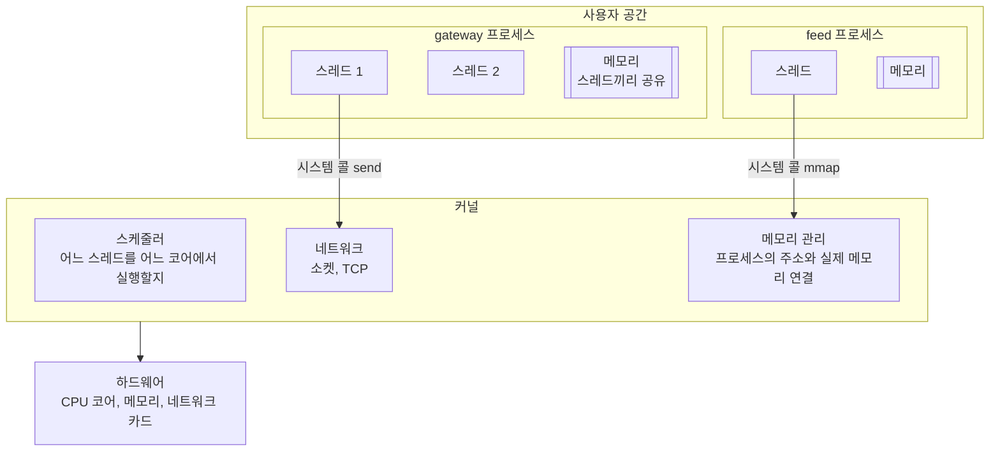

**소켓**은 네트워크 연결의 한쪽 끝이다. 브라우저에서 `new WebSocket(url)`을 실행하면 서버와 TCP 연결이 하나 만들어지고, 서버 프로세스에는 그 연결을 가리키는 소켓이 하나 생긴다. 프로세스는 소켓을 **파일 디스크립터**(fd)라는 정수로 다룬다. fd는 그 프로세스가 열어 둔 파일과 소켓의 목록에서 몇 번째인지를 가리키는 번호이고, 목록 자체는 커널이 관리한다.

**버퍼**는 데이터가 다음 단계로 넘어가기 전에 잠시 머무는 메모리다. 커널은 소켓마다 보낼 데이터를 쌓아 두는 송신 버퍼와 받은 데이터를 쌓아 두는 수신 버퍼를 둔다. `send`는 이름과 달리 상대에게 바이트를 보내는 호출이 아니고 송신 버퍼에 복사해 넣는 호출이며, 실제 전송은 커널이 나중에 한다.

**가상 메모리**는 프로세스마다 자기만의 주소 공간을 갖게 하는 장치다. 프로세스가 쓰는 메모리 주소는 실제 메모리의 주소가 아니고, 그 주소가 실제 메모리의 어디에 해당하는지는 커널이 **페이지**라는 고정 크기의 조각 단위로 표에 적어 관리한다. 프로세스마다 표가 달라서 서로의 메모리를 볼 수 없는데, 두 프로세스의 표에 같은 페이지를 연결해 주면 그 부분만은 함께 볼 수 있다. 이것이 공유 메모리이고, 프론트엔드에서는 `SharedArrayBuffer`가 가장 가깝다.

## 프레임에서 읽을 수 있는 것

종목 페이지를 열고 Network 탭에서 WS만 걸러 보면 목록이 비어 있다. 소켓을 여는 주체가 페이지가 아니라 SharedWorker이기 때문이다. SharedWorker는 같은 출처의 여러 탭이 함께 쓰는 워커이고[^2], Chrome에서는 `chrome://inspect/#workers`에서 워커용 DevTools를 따로 열어야 그 안의 네트워크가 보인다. 나는 CDP(Chrome DevTools Protocol, DevTools가 브라우저와 주고받는 프로토콜)로 워커에 자동으로 붙어 핸드셰이크와 프레임을 받아 적는 스크립트를 만들어 캡처했다.

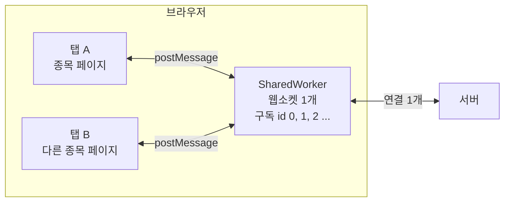

탭을 하나 더 열어 봐도 웹소켓 연결은 하나였다. 둘째 탭의 구독은 같은 연결 위에서 다음 번호의 구독 id로 추가됐고, id는 0부터 30까지 한 번도 재사용되지 않았다. 둘째 탭이 열린 지 0.14초 뒤에는 첫째 탭이 쓰던 구독 13개 중 12개가 해지됐고, 둘째 탭을 닫은 지 0.14초 뒤에는 첫째 탭 종목의 구독이 다시 생겼다. 화면에 보이지 않는 탭의 구독은 해지하는 것으로 보인다. 서버에서 보면 연결 수는 탭 수가 아니라 브라우저 수이고, 구독과 해지는 사용자가 탭을 바꾸기만 해도 일어나는 흔한 일이다.

### 프레임 안의 프레임

DevTools가 한 줄로 보여 주는 프레임은 여러 단계로 포장되어 있다. 맨 바깥은 TCP가 나르는 바이트의 흐름이고, 그 안에 웹소켓 프레임이 있고, 웹소켓 프레임의 내용물이 STOMP 프레임이며, STOMP 프레임의 본문이 JSON이다.

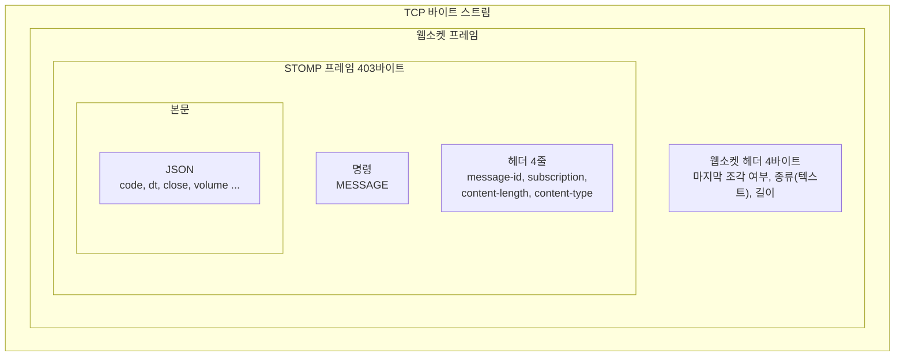

웹소켓 연결은 HTTP 요청 하나로 시작한다. 캡처한 요청과 응답에서 연결의 성격을 정하는 헤더만 추리면 다음과 같다.

```text
GET /ws HTTP/1.1
Host: realtime-socket.tossinvest.com
Upgrade: websocket
Connection: Upgrade
Sec-WebSocket-Version: 13
Sec-WebSocket-Protocol: v12.stomp, v11.stomp, v10.stomp
Sec-WebSocket-Extensions: permessage-deflate; client_max_window_bits

HTTP/1.1 101 Switching Protocols
upgrade: websocket
connection: upgrade
sec-websocket-protocol: v12.stomp
sec-websocket-extensions: permessage-deflate
```

`Sec-WebSocket-Protocol`은 웹소켓 위에서 어떤 프로토콜로 말할지 정하는 헤더다. 클라이언트가 STOMP의 세 버전을 제안했고 서버가 1.2를 골랐다. 웹소켓은 바이트 묶음을 주고받는 방법만 정하고 그 안에 무엇을 담을지는 정하지 않기 때문에, 구독이나 확인 응답 같은 약속은 이렇게 위에 얹은 프로토콜이 맡는다.

웹소켓 프레임 자체의 헤더는 작다. 내용물이 126바이트 이상 65,535바이트 이하이면 길이를 2바이트에 더 적기 때문에 헤더가 4바이트가 된다.[^3] 클라이언트가 보내는 프레임에는 4바이트짜리 마스킹 키가 더 붙는다. 명세가 클라이언트에게는 모든 프레임을 마스킹하라고 하고 서버에게는 마스킹하지 말라고 하기 때문이고[^4], 캡처에서도 보낸 프레임은 전부 마스킹되어 있었고 받은 프레임은 전부 아니었다.

`Sec-WebSocket-Extensions`의 `permessage-deflate`는 메시지를 압축해서 보내겠다는 합의다. 다만 CDP가 넘겨준 내용은 압축을 푼 뒤의 텍스트여서, 실제로 몇 바이트가 오갔는지는 이 캡처에 남아 있지 않다. 대신 캡처한 프레임 686건을 같은 방식으로 직접 압축해 봤다. 연결 하나에서 앞선 메시지들을 사전으로 계속 쓰면 프레임 크기의 중앙값이 403바이트에서 42바이트로 줄고, 메시지마다 사전을 비우면 291바이트까지만 준다. 체결 프레임은 키 이름과 종목 코드가 매번 같아서 앞 메시지를 기억하는지에 따라 효과가 7배 차이 난다. 서버의 응답에는 사전을 이어 쓰지 않겠다는 표시(`server_no_context_takeover`)가 없으므로 이어 쓰는 것이 허용된 상태다.[^5] 그렇게 하려면 서버가 연결마다 압축 상태를 메모리에 들고 있어야 하고, 이 비용은 3편에서 다시 나온다.

### 구독에서 체결까지

웹소켓 위에서 오가는 STOMP는 명령 한 줄, `키:값` 헤더 여러 줄, 빈 줄, 본문, 그리고 NUL 문자(아래에서는 `^@`로 적었다)로 프레임 하나를 만드는 텍스트 프로토콜이다.[^6] STOMP 프레임 하나가 웹소켓 텍스트 메시지 하나에 담긴다. 연결이 열린 뒤의 대화는 다음 순서로 진행된다.

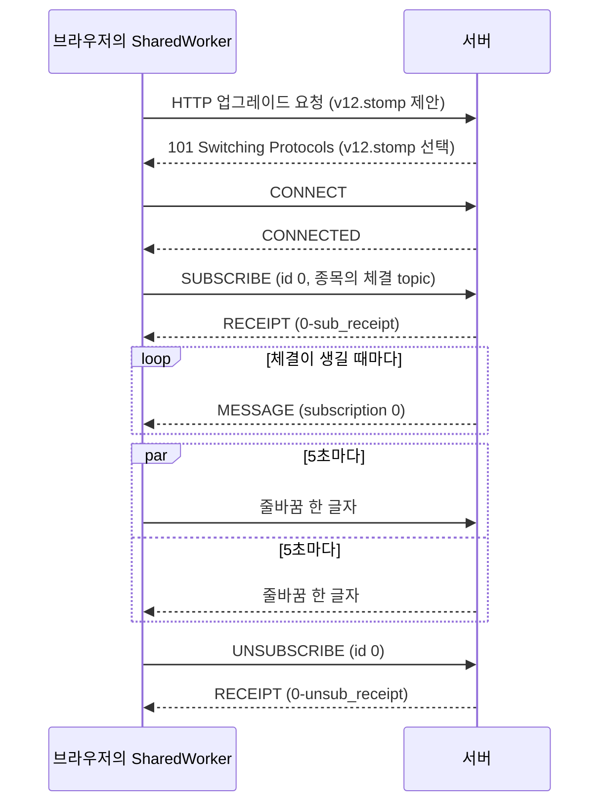

첫 프레임은 `CONNECT`다. 인증과 기기 식별에 쓰이는 값은 지웠다.

```text
CONNECT
device-id:<지움>
connection-id:00000000-0000-4000-8000-000000000000
authorization:<지움>
platform:Web/wts
accept-version:1.2,1.1,1.0
heart-beat:5000,5000

^@
```

```text
CONNECTED
version:1.2
heart-beat:5000,5000

^@
```

`connection-id`는 클라이언트가 만들어 보내는 UUID이고, 뒤에서 `MESSAGE`의 번호에 다시 나온다. `heart-beat:5000,5000`은 "나는 5초마다 살아 있다는 신호를 보낼 수 있고, 상대도 5초마다 보내 주길 바란다"는 뜻이다. 서버도 같은 값으로 답했고, 실제로 클라이언트와 서버가 5초마다 줄바꿈 한 글자를 보냈다. 체결이 없는 종목만 구독한 연결은 몇 분 동안 아무것도 오가지 않을 수 있는데, 이 신호가 없으면 연결이 조용한 것인지 끊어진 것인지 구분할 수 없다.

구독을 요청하는 프레임과 그 응답은 다음과 같다. 클라이언트는 구독마다 `id`를 직접 붙이고, `receipt` 헤더로 처리 확인을 요청한다.

```text
SUBSCRIBE
id:0
receipt:0-sub_receipt
destination:/topic/v1/kr/stock/trade/A005930

^@
```

```text
RECEIPT
receipt-id:0-sub_receipt
message:subscribe success
response-code:200

^@
```

그 뒤로는 체결이 생길 때마다 `MESSAGE`가 온다. 아래 프레임은 헤더와 키의 순서, 값의 자료형은 캡처한 그대로이고 값은 임의로 바꾼 것이다.

```text
MESSAGE
message-id:00000000-0000-4000-8000-000000000000-42
subscription:0
content-length:273
content-type:application/json

{"code":"A005930","dt":"2026-11-19T04:55:12Z","currency":"KRW","exchange":"krx","session":"REGULAR","base":70000,"close":70300,"volume":12,"tradeType":"BUY","changeType":"UP","tradingStrength":104.2857142857142857,"cumulativeVolume":8123456,"cumulativeAmount":571234567800}^@
```

본문의 키 13개는 이름과 값의 범위로 미루어 다음과 같은 뜻으로 보인다.

| 키                                     | 예시 값                       | 짐작한 뜻                                                    |
| -------------------------------------- | ----------------------------- | ------------------------------------------------------------ |
| `code`                                 | `"A005930"`                   | 종목 코드                                                    |
| `dt`                                   | `"2026-11-19T04:55:12Z"`      | 체결 시각. UTC이고 초 단위까지만 있다                        |
| `currency`, `exchange`, `session`      | `"KRW"`, `"krx"`, `"REGULAR"` | 통화, 체결된 거래소, 거래 시간대                             |
| `base`, `close`                        | `70000`, `70300`              | 기준이 되는 가격과 이번 체결의 가격                          |
| `volume`                               | `12`                          | 이번 체결의 수량                                             |
| `tradeType`, `changeType`              | `"BUY"`, `"UP"`               | 매수 체결인지 매도 체결인지, 기준 가격보다 올랐는지 내렸는지 |
| `tradingStrength`                      | `104.2857142857142857`        | 체결강도. 유효 숫자가 최대 19자리까지 왔다                   |
| `cumulativeVolume`, `cumulativeAmount` | `8123456`, `571234567800`     | 그날 그 종목의 누적 거래량과 누적 거래대금                   |

이 표에서 프론트엔드 개발자가 눈여겨볼 값은 `tradingStrength`다. JavaScript의 숫자는 유효 숫자를 17자리 정도까지만 담을 수 있어서, 위 값을 `JSON.parse`로 읽으면 `104.28571428571429`가 된다. 서버는 JavaScript의 숫자보다 정밀한 자료형으로 이 값을 계산하고 자릿수를 그대로 적어 보낸다는 뜻이다. 금융 시스템은 가격을 부동소수점으로 다루지 않는 것이 관례이고, 2편에서 서버 내부의 숫자 표현을 정할 때 이 관찰을 다시 쓴다.

### 프레임이 알려 주는 서버의 상태

23.8초 동안 구독 12개로 받은 `MESSAGE` 686건을 살펴보면, 프레임만으로도 서버가 무엇을 기억하고 있어야 하는지 꽤 많이 알 수 있다.

| 관찰한 것                                                             | 근거                                                                                              | 서버가 갖고 있어야 하는 것                                                          |
| --------------------------------------------------------------------- | ------------------------------------------------------------------------------------------------- | ----------------------------------------------------------------------------------- |
| `message-id`는 `connection-id` 뒤에 1부터 빠짐없이 느는 번호가 붙는다 | 686건이 1부터 686까지 이어졌다                                                                    | 연결마다 카운터 하나, 그리고 그 연결로 나가는 프레임의 순서를 정하는 단 하나의 주체 |
| `MESSAGE`에는 `destination`이 없고 `subscription`만 있다              | 모든 프레임의 헤더가 위 네 개뿐이다                                                               | 연결과 구독 id의 쌍이 어느 종목을 가리키는지                                        |
| 같은 종목을 두 번 구독하면 같은 체결이 두 번 온다                     | id 0과 id 11이 같은 종목이었고, 체결 207건이 연속한 번호의 프레임 두 개로 왔다                    | 종목별이 아니라 구독별로 나뉜 구독자 목록                                           |
| 체결마다 모든 필드가 온다                                             | 국내 종목은 키 13개, 미국 종목은 15개가 매번 같은 순서로 왔다. 프레임 크기의 중앙값은 403바이트다 | 누적 거래량과 누적 거래대금처럼 종목마다 이어지는 값                                |
| 구독 직후에 현재 값을 보내 주지 않는다                                | 구독을 요청한 뒤 첫 `MESSAGE`까지 0.16초에서 10.8초가 걸렸고, 구독 3개는 한 건도 받지 못했다      | 없다. 다음 체결이 생길 때까지 보낼 것이 없다                                        |

첫째 줄은 클라이언트에게도 쓸모가 있다. 번호가 건너뛰면 그 사이의 프레임을 잃었다는 것을 알 수 있기 때문이다. 체결 시각이 초 단위라서 같은 초에 생긴 체결 여러 건의 순서도 이 번호로만 알 수 있다. 넷째와 다섯째 줄을 합치면 화면에 처음 보이는 가격은 웹소켓이 아닌 다른 경로로 받아야 하고, 그 뒤로는 마지막 프레임 하나만 있으면 화면을 그릴 수 있다는 뜻이 된다. 클라이언트가 이전 프레임을 기억해 둘 필요가 없는 형식이다.

둘째 줄은 명세와 다르다. STOMP 1.2는 `MESSAGE` 프레임이 `destination` 헤더를 반드시 포함해야 한다고 적고 있다.[^7] 이 헤더가 있었다면 `destination:/topic/v1/kr/stock/trade/A005930`과 줄바꿈까지 45바이트가 프레임마다 더 붙는다. 403바이트 프레임의 11%에 해당하는 크기이고 본문에 이미 `code`가 있으니, 크기를 줄이려고 뺀 것이 아닐까 짐작한다.

그 밖에 확인한 것이 두 가지 더 있다. 구독 확인(`RECEIPT`)은 항상 그 구독의 첫 `MESSAGE`보다 먼저 왔고, 해지 확인이 온 뒤에는 그 구독의 `MESSAGE`가 한 건도 오지 않았다. 당연해 보이는 동작이지만, 서버 안에서 구독자 목록을 고치는 일과 프레임을 보내는 일이 서로 다른 스레드에서 일어난다면 이 순서를 지키는 데에도 설계가 필요하다. 2편에서 다시 다룬다.

## 체결 한 건이 지나는 길

프레임에서 알 수 있는 것은 여기까지다. 그 앞은 볼 수 없으므로, 체결 시세를 다루는 시스템에서 흔히 쓰는 구성을 따라 아래와 같이 정했다. 굵은 선은 프레임으로 관찰한 구간이고 점선은 내가 상상해서 만든 구간이다.

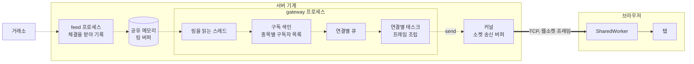

체결 한 건은 다음 순서로 움직인다.

1. **feed 프로세스**가 거래소에서 체결을 받아 내부 형식으로 바꾼다. 내가 만든 서버에는 거래소가 없으므로 feed가 가짜 체결을 만든다.
2. feed는 체결을 **공유 메모리의 링 버퍼**에 쓴다. 링 버퍼는 끝까지 쓰면 처음으로 돌아가 덮어쓰는 고정 크기의 버퍼다.
3. **gateway 프로세스**는 사용자의 웹소켓 연결을 받는 프로세스다. 이 프로세스의 스레드 하나가 링을 읽는다.
4. gateway는 **구독 색인**에서 그 종목을 구독한 연결을 찾아, 연결마다 하나씩 있는 **큐**에 체결을 넣는다.
5. 연결을 맡은 **태스크**가 큐에서 체결을 꺼내 `MESSAGE` 프레임을 만들고 `send`를 호출한다.
6. **커널**이 그 바이트를 TCP로 보내고, 브라우저의 SharedWorker가 받아 탭에 넘긴다.

체결을 받는 일과 연결을 받는 일을 프로세스 두 개로 나눈 데에는 이유가 있다. 프로세스가 서로 다르면 feed가 죽어도 gateway는 살아 있고, 반대도 마찬가지다. 그리고 두 일은 망가지는 방식이 다르다. 거래소와의 연결은 하나뿐이고 끊기면 모든 사용자의 화면이 멈추지만, 사용자 연결은 수가 많고 하나하나는 언제 끊겨도 이상하지 않다. 사용자 연결을 다루는 코드는 자주 바뀌고 배포도 잦을 텐데, 그때마다 거래소와의 연결까지 다시 맺고 싶지는 않다. 반대로 feed를 고쳐서 다시 띄울 때 사용자 1만 명의 웹소켓이 끊기는 것도 피하고 싶다. 사용자가 늘면 gateway만 여러 개로 늘릴 수 있어야 한다는 점도 있다.

이 길에서 체결은 앞에서 정리한 개념들을 차례로 지난다. 공유 메모리로 프로세스 사이를 건너고, 스레드 몇 개가 나눠 맡은 연결 1만 개 중 하나에 배정되고, 시스템 콜로 커널에 넘어가 소켓 버퍼에 쌓인다. 나머지 절에서는 이 네 곳에서 실제로 어떤 일이 생기고 비용이 얼마나 드는지를 직접 재 본다.

## 시스템 콜 한 번의 비용

앞에서 정리한 개념을 실제 프로세스에서 먼저 확인해 봤다. 내가 만든 gateway에 연결 1,000개를 붙여 놓고 운영체제의 도구로 세어 본 결과다.

| 센 것             | 값      | 센 방법                                 |
| ----------------- | ------- | --------------------------------------- |
| 스레드            | 12개    | `ps -M -p <pid>`                        |
| 열려 있는 소켓    | 1,001개 | `lsof -a -p <pid>`에서 종류가 IPv4인 것 |
| 프로세스의 메모리 | 20.6MB  | `ps -o rss= -p <pid>`                   |

연결이 1,000개인데 스레드는 12개뿐이다. 코어 10개에 맞춰 만든 워커 스레드 10개, 링을 읽는 스레드 1개, 프로그램을 시작한 스레드 1개다. 스레드 12개가 연결 1,000개를 감당하는 방법은 뒤의 절에서 다룬다. 소켓 1,001개는 연결 1,000개와 새 연결을 기다리는 소켓 1개다. 소켓 하나가 fd 하나이므로, 연결을 많이 받으려면 프로세스가 열 수 있는 fd 수의 한도(`ulimit -n`)부터 올려야 한다. 같은 목록에는 kqueue라는 종류의 fd도 3개 있었는데, 이것도 뒤에서 다시 나온다.

이 프로세스가 프레임을 내보낼 때마다 부르는 것이 `send` 시스템 콜이다. 한 번 부를 때 다음과 같은 일이 일어난다.

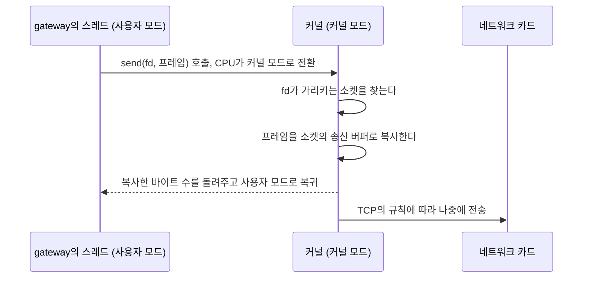

시스템 콜이 함수 호출보다 얼마나 비싼지 직접 쟀다. 같은 프로그램 안에서 네 가지 일을 수백만 번씩 반복하고 한 번에 걸린 시간을 구했다.[^8]

| 한 번에 하는 일                                  | 맥      | Linux |
| ------------------------------------------------ | ------- | ----- |
| 함수 호출                                        | 1.7ns   | 1.6ns |
| 가벼운 시스템 콜(`fstat`, 열린 파일의 정보 읽기) | 240ns   | 202ns |
| 공유 메모리 링에 체결 레코드(63바이트) 쓰기      | 30ns    | 37ns  |
| TCP 소켓에 프레임(370바이트) `send`              | 1,915ns | 381ns |

커널에 다녀오기만 하는 가벼운 시스템 콜도 함수 호출보다 100배 넘게 비싸다. `send`는 그보다 더 비싼데, 커널에 들어간 뒤 프레임을 복사하고 TCP 처리를 해야 하기 때문이다. 셋째 줄은 뒤에 나올 공유 메모리의 값이고, 시스템 콜을 거치지 않아서 `send`보다 10배에서 60배 싸다는 것만 먼저 봐 두면 된다.

이 비용이 중요해지는 것은 호출 횟수 때문이다. 연결 1만 개가 같은 종목을 구독하고 있으면 체결 한 건은 `send` 1만 번이 된다. 위 값을 그대로 곱하면 `send`에만 맥에서는 19ms, Linux에서는 4ms 가까운 CPU 시간이 든다. 여기에 큐에서 꺼내고 프레임을 조립하는 일이 더해진다. 3편에서 Linux로 잰 값을 미리 적으면, 연결이 1만 개일 때 프레임의 절반은 체결이 기록된 지 13.4ms 안에 클라이언트에 도착했고, 연결이 100개일 때는 0.2ms 안에 도착했다. 서버가 한 일의 종류는 같고 횟수만 100배가 됐다.

## 소켓과 버퍼

`send`가 송신 버퍼에 복사해 넣는 호출이라는 것은 앞에서 정리했다. 복사가 끝나면 `send`는 바로 돌아오고, 실제 전송은 커널이 TCP의 규칙에 따라 나중에 한다. 받는 기계에서도 커널이 먼저 수신 버퍼에 쌓아 두고, 애플리케이션이 `recv`로 가져간다. 프레임 하나는 서버 프로세스의 메모리에서 서버 커널의 송신 버퍼로, 네트워크를 건너 사용자 기계 커널의 수신 버퍼로, 다시 브라우저의 메모리로 옮겨진다.

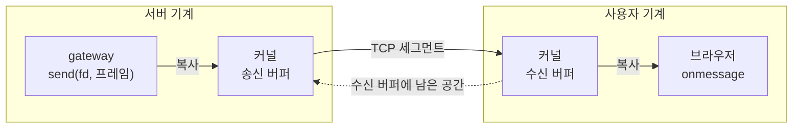

TCP가 그 사이에서 해 주는 일은 세 가지다. 바이트가 보낸 순서대로 도착하게 하고, 중간에 잃어버린 것은 다시 보내고, 받는 기계가 감당할 수 있는 만큼만 보낸다. 셋째가 위 그림의 점선이다. 받는 커널은 수신 버퍼에 남은 공간을 응답에 실어 계속 알려 주고, 보내는 커널은 그 공간을 넘겨서 보내지 않는다.

### 읽지 않는 상대에게 보내기

버퍼가 있어서 생기는 일이 있다. 받는 애플리케이션이 `recv`를 호출하지 않으면 수신 버퍼가 찬다. 남은 공간이 0이라는 것을 알게 된 보내는 커널이 전송을 멈추면 이번에는 송신 버퍼가 찬다. 그러면 `send`는 공간이 생길 때까지 멈추거나, 기다리지 않도록 설정한 소켓에서는 더 넣을 곳이 없다는 오류를 바로 돌려준다.

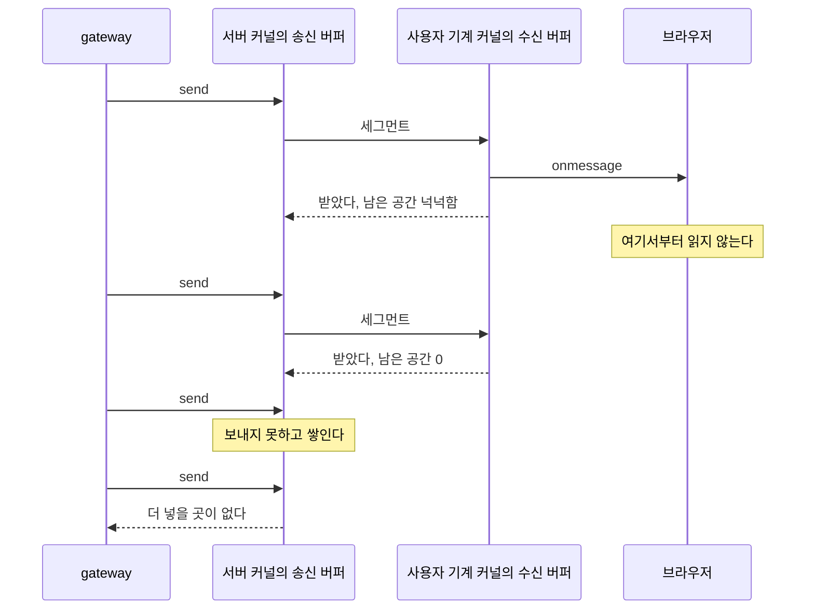

느린 수신자 하나 때문에 생긴 정체가 보내는 프로세스까지 거슬러 올라오는 것이고, 이것을 백프레셔라고 부른다. Node.js로 직접 확인해 볼 수 있다. 아래 스크립트는 403바이트 프레임을 한 바이트도 읽지 않는 상대에게 계속 보내고, 커널이 받아 준 프레임이 몇 개인지 센다.

```js
import net from 'node:net'

const frame = Buffer.alloc(403, 'x')
// 받는 프로그램: 연결은 받지만 한 바이트도 읽지 않는다
const server = net.createServer({pauseOnConnect: true}, () => {})

server.listen(0, '127.0.0.1', () => {
  const client = net.connect(server.address().port, '127.0.0.1')
  let accepted = 0
  let last = Date.now()
  // write의 콜백은 그 데이터가 커널의 송신 버퍼로 넘어갔을 때 불린다
  const send = () =>
    client.write(frame, () => {
      accepted++
      last = Date.now()
      send()
    })
  client.on('connect', send)

  setInterval(() => {
    if (Date.now() - last < 1000) return
    console.log(
      `프레임 ${accepted}개(${accepted * frame.length}바이트)까지 받고 멈췄다`,
    )
    process.exit(0)
  }, 100)
})
```

```text
프레임 1365개(550095바이트)까지 받고 멈췄다
```

이 글을 쓴 맥에서 세 번 돌려 세 번 모두 1,365개였다. 송신 버퍼와 수신 버퍼가 합쳐서 55만 바이트를 받아 준 뒤 더는 받지 않았다. 두 버퍼의 기본 크기는 각각 131,072바이트지만(`sysctl net.inet.tcp.sendspace`, `net.inet.tcp.recvspace`) 커널이 필요에 따라 4,194,304바이트까지 키울 수 있게 되어 있어서(`net.inet.tcp.autosndbufmax`) 기본값의 합보다 많이 들어갔다.

프론트엔드에도 같은 현상을 보여 주는 값이 있다. `WebSocket.bufferedAmount`는 `send()`로 넣었지만 아직 네트워크로 나가지 못한 바이트 수다.[^9] 위 스크립트에서 커널이 멈춘 뒤에도 `write`를 계속 부르면 Node.js가 그 데이터를 자기 메모리에 쌓는데, 브라우저에서는 그 양이 `bufferedAmount`로 보인다.

서버는 같은 상황을 연결 1만 개에서 동시에 겪는다. 그때 서버가 고를 수 있는 것은 세 가지다. 그 연결로 보낼 것을 자기 메모리에 계속 쌓거나, 버리거나, 연결을 끊는다. 초당 체결이 15건인 종목이라면 프레임 1,365개는 91초 분량이다. 91초 동안 읽지 않은 클라이언트에게 그 뒤의 체결까지 쌓아 줄 이유가 있는지가 판단의 기준이 된다. 무엇을 골랐는지는 2편에, 읽지 않는 클라이언트를 일부러 섞어 잰 결과는 3편에 있다.

### 작은 프레임과 Nagle 알고리즘

버퍼와 관련해 하나 더 알아 둘 것이 있다. TCP에는 작은 데이터를 바로 보내지 않고 모았다가 보내는 Nagle 알고리즘이 기본으로 켜져 있다. 키보드 입력처럼 몇 바이트짜리 `send`가 연달아 올 때 패킷 수를 줄이려는 장치다. 체결 프레임은 400바이트 안팎으로 작고 하나하나가 빨리 도착해야 하므로 이 장치와 맞지 않는다. 소켓에 `TCP_NODELAY` 옵션을 켜면 Nagle 알고리즘이 꺼지고, 데이터가 적어도 가능한 한 바로 보낸다.[^10] gateway는 연결을 받자마자 이 옵션을 켠다. 해당 코드는 다음 절에 나온다.

## 연결 1만 개를 기다리는 방법

`recv`는 기본적으로 읽을 것이 올 때까지 돌아오지 않는다. 그동안 그 스레드는 멈춰 있다. 그래서 가장 단순한 서버는 연결마다 스레드를 하나씩 만들고 각자 `recv`에서 기다리게 한다.

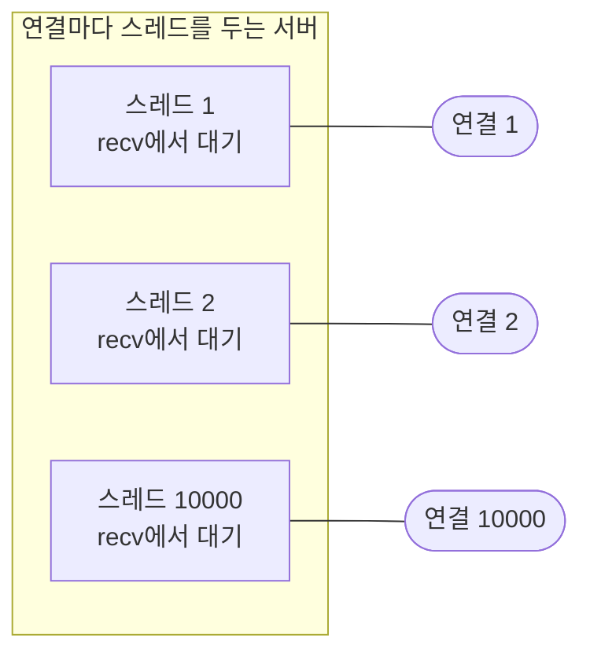

연결이 수백 개일 때는 이 방식으로 충분하다. 1만 개가 되면 스레드도 1만 개가 필요한데, 스레드마다 스택으로 쓸 메모리를 따로 잡아야 하고(Rust 표준 라이브러리의 기본값은 2MiB다[^11]) 커널이 스레드를 번갈아 실행시키는 비용도 든다. 게다가 체결 시세 서버의 연결은 대부분의 시간 동안 클라이언트에게서 받을 것이 없다. 스레드 1만 개가 거의 내내 자고 있게 된다. 서버 한 대로 동시 연결 1만 개를 받는 방법은 1999년부터 "C10K 문제"라는 이름으로 불렸다.[^12]

다른 방법은 기다리는 일을 커널에 맡기는 것이다. 소켓을 읽을 것이 없으면 바로 돌아오는 모드(논블로킹)로 바꿔 두고, 지켜볼 fd를 커널에 등록한 다음, 그중 읽거나 쓸 수 있게 된 것의 목록만 받아 온다. Linux의 epoll[^13]과 macOS의 kqueue가 이 일을 한다. 스레드 하나가 목록을 받아 차례로 처리하고, 처리할 것이 없으면 커널 안에서 잠든다. 앞에서 gateway의 fd를 셀 때 나온 kqueue 3개가 이 등록 창구다.

이 구조가 이벤트 루프다. Node.js가 스레드 하나로 연결 수만 개를 받는 것도 libuv가 epoll과 kqueue를 감싸 이 루프를 돌리기 때문이고[^14], 큐에서 일을 꺼내 실행하고 큐가 비면 기다린다는 점에서 브라우저의 이벤트 루프와도 구조가 같다.

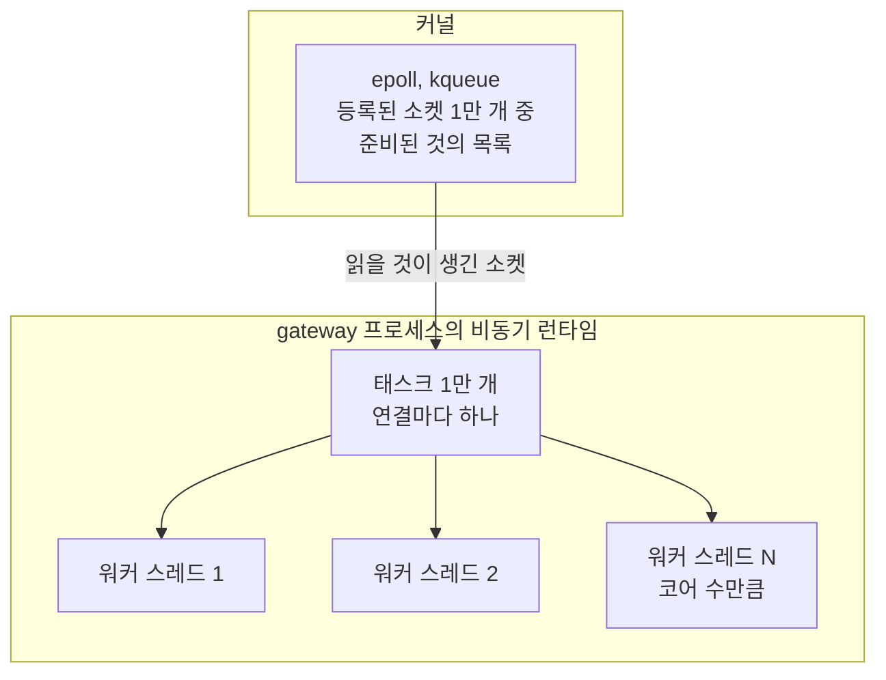

내가 만든 gateway는 Rust의 비동기 런타임인 tokio를 쓴다. 새 연결을 받는 코드는 다음이 전부다.[^15]

```rust
tokio::spawn(async move {
    let mut conn = 0;
    loop {
        match listener.accept().await {
            Ok((stream, _)) => {
                conn += 1;
                // 작은 프레임을 하나씩 flush하므로 Nagle이 켜져 있으면 상대의 지연 ACK를 기다린다. 실패해도 지연만 늘어난다.
                let _ = stream.set_nodelay(true);
                let (heartbeat_ms, queue_capacity) = (config.heartbeat_ms, config.queue_capacity);
                tokio::spawn(connection::serve(stream, accept_hub.clone(), heartbeat_ms, queue_capacity, conn));
            }
            Err(error) => {
                eprintln!("accept 실패: {error}");
                tokio::time::sleep(std::time::Duration::from_millis(100)).await;
            }
        }
    }
});
```

JavaScript를 쓰던 눈에도 낯설지 않은 모양이다. `listener.accept().await`는 새 연결이 올 때까지 이 함수를 멈춰 두고, 그동안 스레드는 다른 일을 한다. `tokio::spawn`은 `async` 함수를 런타임에 맡겨 따로 실행시키는 호출이고, 이렇게 맡겨진 실행 하나를 **태스크**라고 부른다. `await`에서 멈췄다가 준비되면 이어서 실행된다는 점에서 JavaScript의 `async` 함수와 같다. gateway는 연결 하나에 태스크 하나를 만든다.

JavaScript와 다른 점은 루프를 도는 스레드가 여러 개라는 것이다. tokio는 기본 설정에서 CPU 코어 수만큼 워커 스레드를 띄우고, 한가한 워커가 바쁜 워커의 일을 가져가 실행한다.[^16]

|                           | 브라우저의 JavaScript | gateway의 tokio             |
| ------------------------- | --------------------- | --------------------------- |
| 이벤트를 기다리는 곳      | 브라우저 내부         | 커널의 epoll, kqueue        |
| 루프를 도는 스레드        | 메인 스레드 1개       | 코어 수만큼. 이 맥에서 10개 |
| 일의 단위                 | 콜백, `async` 함수    | 태스크                      |
| 두 일이 동시에 실행되는가 | 아니다                | 그렇다                      |
| 공용 데이터를 지키는 장치 | 필요 없다             | 필요하다                    |

연결이 1만 개여도 스레드는 코어 수만큼이고, 태스크 하나가 쓰는 메모리는 스레드의 스택보다 훨씬 작다. 3편에서 잰 값으로는 연결 하나에 13KB였다.

워커가 여러 개라서 얻는 것은 코어를 다 쓸 수 있다는 점이고, 잃는 것은 JavaScript에서 누리던 단순함이다. 두 태스크가 서로 다른 워커에서 동시에 실행될 수 있으므로, 구독자 목록 같은 공용 데이터를 아무 태스크나 고치게 두면 안 된다. 2편에서 구독 색인을 태스크 하나만 만지도록 만든 이유가 이것이다.

익숙한 주의 사항도 그대로 따라온다. JavaScript에서 긴 동기 작업이 메인 스레드를 막듯이, 태스크가 `await` 없이 오래 걸리는 일을 하면 그 워커는 다른 태스크를 실행하지 못한다. 3편에는 워커 10개가 모두 `send` 시스템 콜 안에서 멈춰 있던 측정이 나온다.

## 프로세스끼리 메모리 나눠 쓰기

체결이 지나는 길에서 feed와 gateway는 공유 메모리로 이어져 있다. 두 프로세스의 표에 같은 페이지를 연결하면 그 부분은 함께 볼 수 있다고 앞에서 정리했는데, 그 연결을 커널에 요청하는 시스템 콜이 `mmap`이다. `mmap`은 파일 하나를 프로세스의 주소 공간에 연결해 준다. 두 프로세스가 같은 파일을 공유 모드로 `mmap` 하면 두 프로세스의 표에 같은 실제 페이지가 연결되고, 한 프로세스가 쓴 내용이 다른 프로세스에 바로 보인다.[^17] 연결은 페이지 단위로 이루어지며, 이 글을 쓴 맥에서 페이지 하나는 16,384바이트다(`getconf PAGESIZE`).

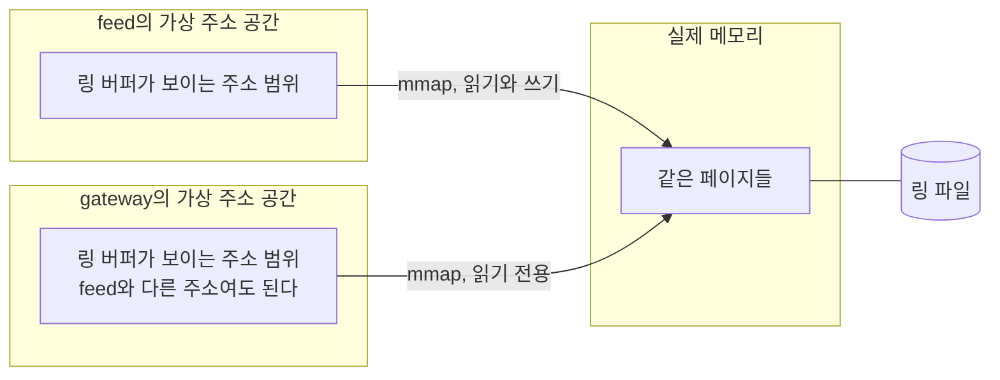

코드로는 몇 줄이다. feed는 읽고 쓸 수 있게, gateway는 읽기만 할 수 있게 같은 파일을 연결한다.[^18]

```rust
pub fn map(file: &File) -> io::Result<Region> {
    Ok(Region::File(MmapRaw::map_raw(file)?))
}

pub fn map_read_only(file: &File) -> io::Result<Region> {
    Ok(Region::File(MmapOptions::new().map_raw_read_only(file)?))
}
```

공유 메모리가 파일에 연결되어 있다는 것은 평범한 도구로도 확인할 수 있다. feed를 띄워 놓고 링 파일의 앞 32바이트를 2초 간격으로 두 번 읽은 결과다.

```text
$ wc -c < ws-trade-feed.ring
 1048640

$ xxd -l 32 ws-trade-feed.ring
00000000: 5753 5249 4e47 3031 0000 1000 0000 0000  WSRING01........
00000010: 2807 0000 0000 0000 2807 0000 0000 0000  (.......(.......

$ xxd -l 32 ws-trade-feed.ring
00000000: 5753 5249 4e47 3031 0000 1000 0000 0000  WSRING01........
00000010: b80f 0000 0000 0000 b80f 0000 0000 0000  ................
```

첫 줄은 이 파일이 링이라는 표시(`WSRING01`)와 데이터 영역의 크기(1,048,576바이트)이고 변하지 않는다. 둘째 줄의 두 숫자는 feed가 어디까지 썼는지를 나타내는 위치로, 2초 사이에 1,832에서 4,024로 늘었다. feed는 파일에 쓰는 시스템 콜을 한 번도 부르지 않았다. 자기 메모리의 한 곳에 값을 썼을 뿐인데, 그 메모리가 이 파일과 같은 페이지라서 파일을 읽는 도구에도 바뀐 값이 보인다. gateway가 보는 것도 같은 페이지다.

### 복사와 공유

프론트엔드의 것에 빗대면 차이가 분명해진다. 워커와 `postMessage`로 주고받는 것은 복사다. 보내는 스레드가 값을 직렬화하고 받는 스레드가 다시 만든다. 프로세스끼리 소켓으로 주고받는 것이 여기에 해당하고, 그때마다 시스템 콜과 커널 버퍼를 거친다. `SharedArrayBuffer`는 복사 없이 같은 메모리를 두 스레드가 함께 본다. `mmap`으로 공유한 메모리가 여기에 해당한다. 한번 연결해 두면 그 뒤로는 시스템 콜 없이 메모리를 쓰고 읽는 것만으로 데이터가 넘어간다.

앞에서 잰 값이 이 차이를 보여 준다. 공유 메모리 링에 체결 레코드 하나를 쓰는 데 30ns가 걸렸고, TCP 소켓에 프레임 하나를 `send` 하는 데 맥에서 1,915ns가 걸렸다. 체결을 받는 프로세스와 내보내는 프로세스 사이는 모든 체결이 지나는 길목이므로, 여기를 소켓 대신 공유 메모리로 이으면 체결마다 시스템 콜 두 번(보내는 `send`와 받는 `recv`)이 없어진다.

### 반쯤 쓰인 값

`SharedArrayBuffer`에 `Atomics`가 함께 딸려 온 이유도 그대로 따라온다. 한 스레드가 값을 쓰는 도중에 다른 스레드가 읽으면 반쯤 쓰인 값을 볼 수 있다. 커널은 페이지를 연결해 줄 뿐이고 그 위에서 누가 언제 읽고 쓰는지는 관여하지 않는다. 링에 레코드를 "길이, 내용" 순서로 쓴다고 하면 다음과 같은 일이 일어날 수 있다.

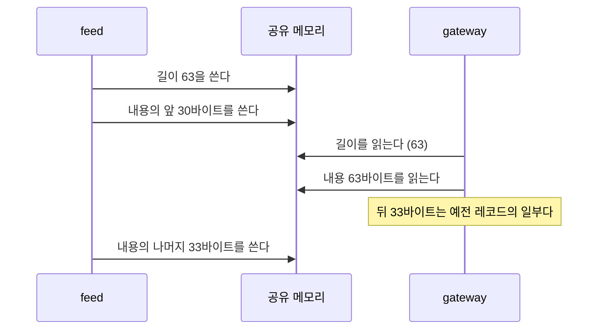

gateway는 오류 없이 63바이트를 읽었지만 그것은 존재한 적 없는 체결이다. 소켓으로 주고받았다면 커널이 순서를 지켜 줬을 텐데, 공유 메모리에서는 feed가 체결 하나를 절반만 쓴 순간에 gateway가 그것을 읽지 않게 하는 규칙을 두 프로세스가 스스로 정해 지켜야 한다. 빠른 대신 안전장치가 없는 길이다. 2편은 그 규칙을 정한 과정이고, 내가 처음 정한 규칙에는 틀린 곳이 다섯 군데 있었다.

## 프레임 한 장이 넘어온 경계

처음의 `MESSAGE` 프레임으로 돌아가면, 그 403바이트는 화면에 닿기 전에 경계를 세 번 넘는다. feed에서 gateway로 프로세스의 경계를 넘고, gateway에서 커널로 넘고, 서버 기계에서 사용자 기계로 넘는다. 프로세스의 경계는 공유 메모리 덕분에 체결 한 건에 30ns짜리 쓰기 한 번으로 넘지만, 커널의 경계는 그 종목을 구독한 연결 수만큼 넘어야 하고 한 번에 그 수십 배가 든다.

서버를 만들고 측정하면서 문제가 생긴 곳도 대부분 이 경계였다. 공유 메모리에서는 읽기와 쓰기의 순서를 잘못 정했고, 커널의 경계에서는 연결 수만큼 늘어나는 호출이 지연이 됐으며, 측정하던 맥에서는 서버보다 커널의 네트워크 메모리가 먼저 한계에 닿았다. 프레임을 받기만 할 때는 보이지 않던 일들이다.

[^1]: 서버와 캡처 도구, 측정 결과는 [yceffort/ws-trade-server](https://github.com/yceffort/ws-trade-server)에 있다. 프레임은 2026년 11월 19일에 로그인하지 않은 임시 프로필의 헤드리스 Chrome Beta 159로 받았다. 캡처에 들어 있던 인증 헤더와 기기 식별자, 실제 시세 값은 저장소와 이 글에 옮기지 않았다.

[^2]: [MDN, SharedWorker](https://developer.mozilla.org/en-US/docs/Web/API/SharedWorker)

[^3]: [RFC 6455, 5.2. Base Framing Protocol](https://www.rfc-editor.org/rfc/rfc6455#section-5.2)

[^4]: [RFC 6455, 5.1. Overview](https://www.rfc-editor.org/rfc/rfc6455#section-5.1). 원문은 "a client MUST mask all frames that it sends to the server", "A server MUST NOT mask any frames that it sends to the client"이다.

[^5]: [RFC 7692, 7.1.1.1. Server No Context Takeover](https://www.rfc-editor.org/rfc/rfc7692#section-7.1.1.1). 압축 계산은 캡처한 `MESSAGE` 686건을 zlib의 raw deflate로 압축하고 RFC 7692가 정한 대로 끝 4바이트를 뺀 크기다. 실제 서버의 압축 설정은 이 계산에 반영하지 않았다.

[^6]: [STOMP Protocol Specification, Version 1.2, STOMP Frames](https://stomp.github.io/stomp-specification-1.2.html#STOMP_Frames)

[^7]: [STOMP Protocol Specification, Version 1.2, MESSAGE](https://stomp.github.io/stomp-specification-1.2.html#MESSAGE). 원문은 "The MESSAGE frame MUST include a destination header indicating the destination the message was sent to."이다.

[^8]: 측정 코드는 저장소의 `examples/boundary_cost.rs`다. 맥은 Apple M5(10코어)의 macOS이고, Linux는 같은 기계의 OrbStack 가상 머신(Linux 7.0.14, aarch64)에서 코어 4개에 고정해 돌렸다. 컴파일러는 rustc 1.95.0이다. 세 번씩 돌렸고 `send`를 뺀 값은 세 번이 거의 같았다. Linux의 `send`는 347ns, 381ns, 443ns였고 표에는 가운데 값을 적었다. `send`는 소켓 하나에 연달아 보내고 다른 스레드가 계속 읽어 주는 조건이다.

[^9]: [MDN, WebSocket: bufferedAmount property](https://developer.mozilla.org/en-US/docs/Web/API/WebSocket/bufferedAmount)

[^10]: [Linux man-pages, tcp(7)](https://man7.org/linux/man-pages/man7/tcp.7.html)의 `TCP_NODELAY`

[^11]: [Rust 1.95.0 표준 라이브러리, std::thread의 Stack size 절](https://doc.rust-lang.org/1.95.0/std/thread/index.html#stack-size)

[^12]: [Dan Kegel, The C10K problem](https://www.kegel.com/c10k.html)

[^13]: [Linux man-pages, epoll(7)](https://man7.org/linux/man-pages/man7/epoll.7.html)

[^14]: [libuv 문서, Design overview](https://docs.libuv.org/en/v1.x/design.html)

[^15]: [yceffort/ws-trade-server `05ae6632` `src/lib.rs` L54-L71](https://github.com/yceffort/ws-trade-server/blob/05ae66329025da3cd67b05957f21c4d3d613e11f/src/lib.rs#L54-L71)

[^16]: [tokio 1.54.1 문서, tokio::runtime](https://docs.rs/tokio/1.54.1/tokio/runtime/index.html#multi-thread-scheduler)

[^17]: [Linux man-pages, mmap(2)](https://man7.org/linux/man-pages/man2/mmap.2.html). `MAP_SHARED`의 설명은 "Updates to the mapping are visible to other processes mapping the same region"이다.

[^18]: [yceffort/ws-trade-server `05ae6632` `src/region.rs` L16-L22](https://github.com/yceffort/ws-trade-server/blob/05ae66329025da3cd67b05957f21c4d3d613e11f/src/region.rs#L16-L22)
