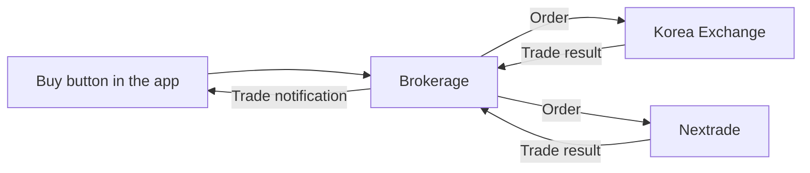
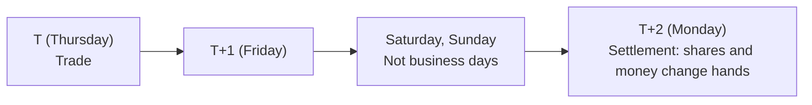
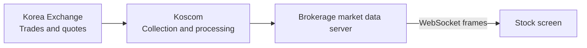

Beyond "buying and selling," I knew almost nothing about stocks. My understanding stopped at this: pick a stock in an app, press buy and you get shares, press sell and you get money. But when I looked into the trade frames arriving on a stock screen, several values were hard to make sense of. A trade, or execution, means a deal has been struck between someone who wants to buy and someone who wants to sell.

Around 2 p.m. on November 19, 2026, I received 686 trade frames over 24 seconds from the Toss Securities web app. Of the 651 frames for Korean stocks, 182 had `nxt` instead of `krx` in `exchange`. The 35 frames for U.S. stocks were executed just before midnight U.S. Eastern Time, yet their `session` was `DAY`. Nine of the Korean frames carried `UPPER_LIMIT` instead of `UP`, which means the price went up. That day, the Korean stock market opened an hour later than usual.[^1]

In this first post of the [Building a Stock Trade WebSocket Server](/series/websocket-trade-server) series, before getting to the server, I work out what these values mean. Using an order to buy 10 shares of Samsung Electronics as the example, I follow whom you buy from, at what price and how many shares, when you buy, and what remains after the purchase. At the end, I connect the market data that reaches the screen along the way to the fields in the frame. The prices in the examples are the actual quotes at the end of trading on November 20, 2026.

Market rules change more often than you might expect. A second stock exchange opened in March 2025, and in September 2026 Korea Exchange extended its trading hours to 8 p.m. This post reflects the rules as of November 21, 2026. Sources for rules and figures are in the footnotes, and conditions that differ by brokerage are noted in the text.

## Table of Contents

## Whom You Buy From

For you to buy a stock, someone has to sell it. An exchange matches buy and sell orders placed by people who don't know each other. Most Korean stocks are listed on Korea Exchange (KRX). Listing means registering a stock so it can be bought and sold on the exchange. KRX runs the KOSPI market (officially the "securities market"), KOSDAQ, and KONEX, and Samsung Electronics is a KOSPI stock.

Investors can't send orders to the exchange directly. You open an account at a brokerage that is a KRX member and hand it your order, and the brokerage submits it to the exchange. KRX requires member brokerages to submit orders received from customers immediately. Trade results also reach the customer through the brokerage.[^2] That is why an order to buy 10 shares of Samsung Electronics in an app goes to the brokerage first.



### After There Were Two Exchanges

When Nextrade (NXT) began operating on March 4, 2025, brokerages gained another place to send orders. Legally, Nextrade is a multilateral trading company, and it is commonly called an alternative trading system (ATS).[^3] It doesn't list new stocks; it trades a selection of the stocks listed on KRX. The number of eligible stocks grew to nearly 800 within a month of launch. Later, there were reports that it fell to just over 600 in 2026 because of an enforcement decree that caps alternative trading system volume below a set ratio relative to KRX.[^4]

Until Nextrade arrived, Korean stocks traded only on KRX. The multilateral trading company framework, which allows listed stocks to be bought and sold outside the exchange, was introduced in 2013. The Financial Services Commission (FSC) describes it as a way to diversify securities market infrastructure and make trading more convenient for investors. Yet for 10 years after its introduction no one was licensed, until Nextrade became the first to receive preliminary approval in July 2023.[^3]

The FSC expected that once Nextrade opened, combined trading hours across the two exchanges would stretch to 12 hours a day and order types would become more varied. It also expected fee competition between exchanges to lower trading costs. Nextrade said it would charge brokerages execution fees 20-40% lower than KRX.[^3] KRX introduced mid-price orders on Nextrade's launch day, and in September 2026 it opened an after-market session running until 8 p.m. Mid-price orders are covered later under "Order Types."

Since the same Samsung Electronics shares can now be sold in two places, the brokerage has to decide where to send an order. Brokerages have a duty to execute customer orders on the most favorable terms (best execution). So brokerages run a system that compares the prices currently available on the two exchanges and picks where to send each order (SOR, Smart Order Routing).[^3] Which exchange gets orders at which times follows criteria each brokerage sets.

The two exchanges could be told apart in the capture too. Of 651 domestic trades, 469 were on KRX and 182 (28%) were on Nextrade. For Samsung Electronics alone, 98 of 415 trades were on Nextrade. `exchange` appears to be the field indicating which exchange the trade took place on.

### Stock Codes

An order also has to name the stock. Samsung Electronics' stock code is `005930`. This six-digit number is called the short code, and the 12-character standard code that follows the international standard (ISIN) is `KR7005930003`.[^5] The standard code consists of the country code `KR`, a nine-character identifier, and a final check digit, with the short code `005930` sitting unchanged in the middle. Computing the check digit from the first 11 characters with the ISIN method (convert letters to numbers, then apply the Luhn algorithm) does give the final 3.

You also often see a form with an `A` in front, like `A005930`. In KRX's short code scheme, the first character indicates the product type: `A` for stocks and `Q` for ETNs.[^6] The subscription address in the capture was `/topic/v1/kr/stock/trade/A005930` as well.

U.S. stocks are usually referred to by a ticker such as `AAPL`. But the subscription addresses for U.S. stocks in the capture contained values like `US19990122001` and `NAS0231213008` instead of tickers. They consist of a prefix that looks like an exchange name followed by digits, so I am guessing they are the brokerage's own identifiers for overseas stocks.

## At What Price, and How Many Shares

### Quotes and Trades

An order includes a price and a quantity. An order that sets a price, like "buy 10 shares at 180,900 won," is called a quote, and the quotes that reach the exchange gather by price into an order book. Below is the Samsung Electronics order book I saw on Naver Pay Securities after all trading had ended on November 20, 2026.[^7]


The blue area at the top holds sell quotes and the red area at the bottom holds buy quotes. The lowest price anyone is willing to sell at, the best ask, is 180,900 won, with 2,561 shares waiting at that price. The highest price anyone is willing to pay, the best bid, is 180,800 won, for 590 shares. The two prices are 100 won apart, so no trade happens in this state. KRX publishes the 10 best price levels on each side, buy and sell, along with the quantity resting at each price (the remaining quantity).[^8] The 20 prices on the screen show these quotes.

The outlined 180,900 won is the last traded price, and the percentage next to each price is the change from the base price (196,900 won). That day, Samsung Electronics' regular-session closing price was 183,100 won (-7.01%). By the end of the after-market, it had finished trading more than 8% below the base price.

Trading had already ended, so an order placed at this point would not execute. Suppose the market were open. If an order to buy 10 shares at 180,900 won arrived at this order book, it would **trade** against 10 of the 2,561 shares waiting to be sold at that price. The remaining 2,551 shares stay in the book. If there were a sell quote at a lower price, it would come first, and among quotes at the same price, the one that arrived first trades first. This is called price priority and time priority.[^9]

<LiveDemo src="/demos/websocket-trade-server-securities-basics/index.html?view=book&lang=en" title="Compare with the buttons how an order would be matched against the order book if the market were open. If the price matches, it trades immediately; if not, it waits in line" height={480} />

In this example, the buyer placed an order at the sell quote. Brokerage screens classify such a trade as a buy trade. Conversely, when a seller places an order at the buy quote, it is classified as a sell trade.[^10] The `BUY` and `SELL` in the frame's `tradeType` appear to follow this distinction. The capture had 457 `BUY` trades and 229 `SELL` trades.

### Tick Size

The prices in the order book are 100 won apart because of the tick size. An order price must align with the unit set for each price range.[^11]

| Price range                  | Tick size |
| ---------------------------- | --------- |
| Under 2,000 won              | 1 won     |
| 2,000 to under 5,000 won     | 5 won     |
| 5,000 to under 20,000 won    | 10 won    |
| 20,000 to under 50,000 won   | 50 won    |
| 50,000 to under 200,000 won  | 100 won   |
| 200,000 to under 500,000 won | 500 won   |
| 500,000 won and above        | 1,000 won |

Samsung Electronics, priced around 180,000 won, can only be quoted in 100-won steps, so an order to buy at 180,850 won can't be placed. The current ranges were set on January 25, 2023, when the KOSPI and KOSDAQ markets were brought under the same table.[^11]

Yet 22 of the captured domestic trades (16 on KRX, 6 on Nextrade) were priced exactly at half a tick. In terms of the order book above, that is a price like 180,850 won between 180,800 won and 180,900 won. Since March 2025, both exchanges accept mid-price orders, which trade at the exact midpoint between the best bid and the best ask.[^12] When the gap between the two is one tick, as in the order book above, a mid-price execution produces exactly this kind of price. Whether those 22 trades were actually mid-price executions can't be determined from the frames alone.

### Order Types

Not every order sets a price. The order types KRX accepts are as follows.[^13]

| Type                    | Meaning                                                                                                          |
| ----------------------- | ---------------------------------------------------------------------------------------------------------------- |
| Limit                   | Trades only at the set price or a better one                                                                     |
| Market                  | Sets only a quantity, no price, and trades immediately at the best available price                               |
| Conditional limit       | Sits as a limit order during the session and, if unfilled, converts to a market order at 15:20 just before close |
| Best-counterparty limit | At the moment it arrives, the best price on the opposite side becomes the order price                            |
| Best-own-side limit     | At the moment it arrives, the best price on your own side becomes the order price                                |
| Mid-price               | Trades at the exact midpoint between the best bid and the best ask                                               |

You can attach conditions as well. IOC (Immediate or Cancel) fills whatever can be filled right now and cancels the rest, and FOK (Fill or Kill) fills only if the whole order can be filled right now and otherwise cancels all of it. Nextrade added stop-limit orders, which become limit orders when the price reaches a set level.[^3]

With the order book above during the session, a limit order for Samsung Electronics at 180,900 won would execute immediately. A limit order at 180,800 won would line up behind the 590 shares at the top of the buy side and wait for someone to sell at 180,800 won.

### How Far a Price Can Move in a Day

Korean stocks have a fixed daily range: 30% above and below the base price. The highest price a stock can reach in a day is called the upper limit, and the lowest is the lower limit.[^14] The base price is usually the previous day's closing price (the last price traded in the regular session). The daily price limit started at 6% in 1995, went through 8%, 12%, and 15%, and became 30% on June 15, 2015. The upper limit is found by multiplying the base price by 0.3, dropping any amount smaller than the tick size, and adding the result to the base price.[^14]

In the order book above, Samsung Electronics' base price was 196,900 won. Multiplying by 0.3 gives 59,070 won. Dropping the amount smaller than the base price's tick size (100 won) leaves 59,000 won, and subtracting that from the base price gives a lower limit of 137,900 won. Adding it gives 255,900 won, but that price falls in the 200,000-won-and-above range, where the tick size is 500 won. Dropping the amount to fit that tick size again makes the upper limit 255,500 won.

The 9 captured trades marked `UPPER_LIMIT` were for two stocks. For both, the upper limit computed by plugging the frame's `base` into this formula matched `close` in all 9 trades. The same calculation also confirms that `base` is the base price for the daily price limit.

The U.S. has no daily price limit like Korea's. Instead, during the regular session (9:30 a.m. to 4 p.m. U.S. Eastern Time), each stock gets a tradable price range based on its average price over the last five minutes. The mechanism that blocks trades outside this range is LULD (Limit Up-Limit Down). If the best bid or best ask stays at the edge of the range for 15 seconds, trading in that stock halts for five minutes.

The width of the range varies by stock, price, and time. For stocks whose previous close is above 3 dollars, it is 5% for those in the S&P 500 or Russell 1000 and 10% for the rest. Stocks at 3 dollars or below get wider ranges, and some stocks have their range doubled in the last 25 minutes of the regular session. There is also a mechanism that halts the whole market. On a normal trading day, if the S&P 500 falls 7% or 13% below the previous close before 3:25 p.m. Eastern Time, trading halts for 15 minutes at each level. A 20% drop ends trading for the day at any time during the regular session.[^15] The tick size is 0.01 dollars (1 cent) for stocks priced at 1 dollar or more.

### How Many Shares

Korean stocks trade in units of one share.[^11] At 180,900 won per share, 10 shares cost 1,809,000 won, and an order for just 100,000 won's worth can't be sent to the exchange.

Fractional trading works by the brokerage pooling customer orders. For Korean stocks, the brokerage gathers fractional orders and buys shares on the exchange as they add up to whole shares. It places those shares in trust with the Korea Securities Depository and divides them into beneficiary certificates for customers. For overseas stocks, the brokerage records customers' fractional holdings directly in its own account ledger.[^16]

Fractional trading of Korean stocks began in 2022 at brokerages designated under the innovative financial services program, after the FSC announced in September 2021 that it would allow it.[^16] In May 2025, an amendment to the enforcement decree was announced to make this structure a formal part of the rules. The amendment is now in effect, and many brokerages offer the service.

The `volume` of all 686 captured trades, domestic and U.S., was a whole number. That is consistent with fractional orders being pooled into whole shares inside the brokerage before going to the exchange. Still, there were only 35 U.S. trades, so this alone doesn't confirm it.

## When You Buy

### A Day at Korea Exchange and Nextrade

The saying that the stock market opens at 9 a.m. and closes at 3:30 p.m. refers to the regular session. You can also trade before and after it, and the matching method changes by time of day. The weekday schedule as of November 2026 is as follows.[^17]

<LiveDemo src="/demos/websocket-trade-server-securities-basics/index.html?view=day&lang=en" title="A day at Korea Exchange and Nextrade. Hover over a bar to see the exact times" height={392} />

The exact times for each segment are as follows.

| KST         | Korea Exchange                                                             | Nextrade                                                 |
| ----------- | -------------------------------------------------------------------------- | -------------------------------------------------------- |
| 08:00-08:30 | Closed                                                                     | Pre-market (continuous trading)                          |
| 08:30-08:50 | Opening auction order entry, pre-hours closing-price trading (until 08:40) | Pre-market (continuous trading)                          |
| 08:50-09:00 | Opening auction order entry                                                | Paused                                                   |
| 09:00-15:20 | Regular session (continuous trading)                                       | Main market (continuous trading, from 09:00:30)          |
| 15:20-15:30 | Closing auction                                                            | Paused                                                   |
| 15:30-15:40 | Post-hours closing-price order entry                                       | After-market order entry, closing-price trading          |
| 15:40-16:00 | Post-hours closing-price trading                                           | After-market (continuous trading), closing-price trading |
| 16:00-20:00 | After-market (continuous trading)                                          | After-market (continuous trading)                        |

**Continuous trading** and **single-price auctions** in the table are ways of executing orders. The FSC describes continuous trading as a method in which "trades are executed as soon as prices match" and a single-price auction as one that "collects quotes and executes them at once at a single price."[^3] The earlier example, where an order to buy at 180,900 won traded as soon as it arrived, is continuous trading. Each new order is checked against the order book as it arrives, so the trade price can differ every time.

In a single-price auction, orders are only collected for a set period. When the period ends, a single price is set by looking at all the collected orders, and they execute together.[^18] Here a limit order can also execute at a price better than its limit. A buy order at 181,200 won means "I'll pay up to 181,200 won," so it can buy for less. A sell order at 180,600 won likewise means "I'll sell at 180,600 won or more," so it can sell for more.

Suppose only the following orders for Samsung Electronics came in between 8:30 and 9:00 (values made up for illustration).

| Sell quantity | Price   | Buy quantity |
| ------------- | ------- | ------------ |
| 600           | 181,200 | 300          |
| 400           | 181,000 | 500          |
|               | 180,800 | 400          |
| 200           | 180,600 |              |

Suppose the price were set at 181,000 won. The buy orders that can trade at this price are the 300 shares willing to pay up to 181,200 won and the 500 shares willing to pay up to 181,000 won, 800 shares in total. The sell orders that can trade are the 200 shares willing to sell at 180,600 won or more and the 400 shares willing to sell at 181,000 won or more, 600 shares in total. The sell side is smaller, so the quantity that can actually trade is 600 shares. Other prices can be worked out the same way. Click a price below to see the orders and the quantity that can trade at that price.

<LiveDemo src="/demos/websocket-trade-server-securities-basics/index.html?view=auction&lang=en" title="For each candidate price, the quantity buyers want, the quantity sellers offer, and the quantity that can actually trade" height={550} />

Raising the price to 181,200 won shrinks the buy orders to 300 shares, and lowering it to 180,800 won or below shrinks the sell orders to 200 shares. In between, at 181,000 won, the tradable quantity is largest, and in this example that price becomes the day's opening price. Pairing orders the way KRX's rules describe, starting from the highest buy and the lowest sell, gives the same 600 shares at the same 181,000 won.[^18]

All 600 shares trade at 181,000 won. The buyer willing to pay up to 181,200 won pays 200 won less, and the seller willing to sell at 180,600 won or more gets 400 won more. Of the 500-share buy order at 181,000 won, 200 shares go unfilled because there aren't enough sellers. The 180,800-won buy and the 181,200-won sell remain as they are, since their prices don't meet.

Had the same orders arrived one by one after 9:00, they would have traded at different prices depending on the order in which they came in. A single-price auction processes 30 minutes of collected orders at once, so a single trade price results.

The opening and closing prices represent the day, so they are set after collecting enough orders. This keeps a few early orders from deciding the price. KRX describes the single-price auction as a method used "where there is a strong need to concentrate supply and demand to form an equilibrium price."[^18]

For the opening price, orders are collected from 8:30 to 9:00, and for the closing price, from 15:20 to 15:30. During that time there are no trades; instead an indicative price is shown, calculated as what the price would be if the auction closed now. For the opening auction, the indicative price is published only in the last 10 minutes, from 8:50 to 9:00.[^3]

The end time also varies. The opening auction ends at a random moment within 30 seconds after 9:00, and the closing auction within 30 seconds after 15:30. If the exact end time were known, it would be easier to move the indicative and opening prices by placing and pulling quotes just before it. KRX's rules also describe this as a safeguard against unfair trading.[^18]

Around the regular session there are also periods that trade only at the closing price. Pre-hours closing-price trading (8:30 to 8:40) trades at the previous day's close, and post-hours closing-price trading (15:40 to 16:00) at that day's close. Since September 14, 2026, an after-market session using continuous trading has run from 16:00 to 20:00. With it, the old after-hours single-price trading (a segment from 16:00 to 18:00 that matched every 10 minutes at a single price) was abolished.[^17]

The after-market's daily price limit is also 30% of the previous close. But even if the price moves in the after-market, the day's official closing price stays at the price set at 15:30. In the order book above, the last after-market price was 180,900 won, but the day's closing price is the 183,100 won set in the regular session.[^7]

Nextrade runs a pre-market from 8:00 to 8:50, a main market from just after 9:00 to 15:20, and an after-market from 15:30 to 20:00.[^3] According to brokerage guides, the main market starts at 9:00:30. The after-market accepts orders from 15:30 but only collects them for the first 10 minutes, and starts executing at 15:40. Separately, a closing-price market that trades only at that day's KRX closing price is open from 15:30 to 16:00.[^19]

From 8:50 to 9:00, when KRX publishes the opening indicative price, and from 15:20 to 15:30, during the closing auction, Nextrade pauses trading. Each pause lasts 10 minutes. The FSC explains that this preserves the representativeness of the opening and closing prices and prevents price manipulation that exploits the difference between the two matching methods.[^3] The main market starting at 9:00:30 rather than 9:00 sharp also lines up with KRX's opening auction ending within 30 seconds after 9:00.

A Samsung Electronics order is handled differently depending on when it is placed. At 8:10, it could trade immediately in Nextrade's pre-market. At 8:55, Nextrade is paused and KRX is collecting quotes. An order placed then executes together with the other orders when the opening price is set just after 9:00, or stays unfilled if its conditions aren't met. At 9:00 and 15:30, when collected orders execute all at once, trade data is also likely to spike. A server sending trade frames would need to account for the load at these times.

### When Trading Pauses

When a price moves sharply in a short time, the trading method changes temporarily. The mechanism applied to an individual stock is the volatility interruption (VI). There is a dynamic VI, triggered when the price moves a certain percentage from the last trade, and a static VI, triggered by a move of 10% or more from the last single-price auction price (the previous close before the opening price is set). Either way, the stock switches to a single-price auction for two minutes.[^20]

| Category                      | Dynamic VI (regular session, after-market) | Dynamic VI (closing auction) | Static VI |
| ----------------------------- | ------------------------------------------ | ---------------------------- | --------- |
| KOSPI 200 constituents        | 3%                                         | 2%                           | 10%       |
| Other KOSPI and KOSDAQ stocks | 6%                                         | 4%                           | 10%       |

Samsung Electronics is a KOSPI 200 constituent. If the last trade was at 180,900 won, a dynamic VI triggers when the next trade price moves 5,427 won or more, which is 3% of that price.

When the whole market plunges, trading itself stops. If the KOSPI stays 8% or more below the previous close for one minute, all trading halts for 20 minutes (circuit breaker level 1). At 15% it halts once more, and at 20% trading ends for the day. Levels 1 and 2 each trigger at most once a day. To leave time to set the closing price, they don't trigger from 40 minutes before the close (normally 2:50 p.m.). Level 3, which ends the day's trading, can still trigger after that. Circuit breakers apply only to the regular session and don't trigger in the after-market.[^21]

There is also a sidecar: if KOSPI 200 futures move 5% or more for one minute, only program trading orders are suspended for five minutes.[^21]

### Days Off and Late Openings

The market is closed on Saturdays and Sundays, public holidays, Labor Day on May 1, and the last weekday of the year (counted excluding public holidays and Saturdays).[^17] On the day of the College Scholastic Ability Test, Korea's national college entrance exam, the regular session opens an hour late and closes an hour late. On November 19, 2026, the exam day, the regular session ran from 10:00 to 16:30, and Nextrade did not open its morning pre-market.[^22]

The frames in this post were also captured on exam day. At around 2 p.m., the time fell within the regular session even under the delayed schedule, and the `session` of every domestic trade was `REGULAR`.

### U.S. Hours and Daylight Saving Time

The U.S. regular session runs from 9:30 a.m. to 4 p.m. U.S. Eastern Time. There are pre-market and after-market sessions before and after it, with hours that vary by exchange. On Nasdaq, the pre-market starts at 4 a.m. and the after-market runs until 8 p.m.[^23]

Converting to Korean time means accounting for daylight saving time. The U.S. moves clocks forward an hour at 2 a.m. on the second Sunday in March and back at 2 a.m. on the first Sunday in November. This is called daylight saving time (DST). In 2026 it ran from March 8 to November 1.[^24] Korea has no daylight saving time, so the gap with U.S. Eastern Time is 13 hours during that period and 14 hours the rest of the year. Seen from Korea, the opening and closing times of the U.S. market shift by an hour twice a year.

| U.S. Eastern Time            | KST (during DST) | KST (rest of year) |
| ---------------------------- | ---------------- | ------------------ |
| 4:00 Pre-market opens        | 17:00            | 18:00              |
| 9:30 Regular session opens   | 22:30            | 23:30              |
| 16:00 Regular session closes | 5:00 next day    | 6:00 next day      |
| 20:00 After-market ends      | 9:00 next day    | 10:00 next day     |

The U.S. regular session runs past midnight in Korean time. A Friday session in the U.S. ends early Saturday morning in Korea. When showing "today's" prices on screen, you have to decide which country's date to use. Sending the frame's `dt` in UTC is probably related to these time differences. U.S. market holidays also need checking separately. In 2026, the market is closed on November 26 for Thanksgiving, and the next day closes early at 1 p.m. U.S. Eastern Time (3 a.m. on November 28 in Korea).[^23]

U.S. stocks can be traded during the Korean daytime too, through a daytime trading service that Korean brokerages offer via U.S. alternative trading systems. During the market plunge on August 5, 2024, the U.S. ATS Blue Ocean unilaterally canceled orders it had received, and Korean brokerages all suspended daytime trading from August 16. They then signed contracts with other ATSs such as Bruce and Moon to add counterparties, and put in place a way to roll back balances when errors occur. On November 4, 2025, 18 brokerages resumed daytime trading.[^25]

Hours differ by brokerage. Outside daylight saving time, some offer it from around 10 a.m. to around 5:30 p.m.[^25] In Korean time, daytime trading is followed by the pre-market at 18:00 and the regular session at 23:30, and the after-market runs until 10:00 the next day. The hours in a day during which U.S. stocks can be traded have grown that much longer.

<LiveDemo src="/demos/websocket-trade-server-securities-basics/index.html?view=us&lang=en" title="U.S. stock trading hours laid over a day in Korean time. When daylight saving time ends, every segment shifts an hour later" height={266} />

The captured U.S. trades were executed around 2 p.m. on November 19 Korean time, which was just before midnight on November 18 U.S. Eastern Time. The U.S. exchanges' after-market had ended by then, so `session:"DAY"` appears to mark trades from this daytime trading.

There is still nowhere to trade U.S. stocks on weekends, but there are moves to extend trading hours. Bruce Markets, which runs Bruce, announced on September 30, 2026, that it would open a weekend trading session within a few months, subject to regulatory review.[^26] Blue Ocean also said in March 2026 that it was preparing clearing and settlement arrangements with the clearing firm RQD Clearing and with DTCC, which handles securities clearing and settlement in the U.S., so that tokenized U.S. stocks could trade on weekends.[^27] As of November 21, 2026, neither had announced the opening of a weekend session.

Once weekend trading starts, market data servers will have to send trades on weekends too. Using weekends for system maintenance will also become harder than it is now. The Toss Securities web app was showing a notice of full-service maintenance on Saturday, November 28.

## After You Buy

### Trade and Settlement

When 10 shares of Samsung Electronics trade at 180,900 won, the app immediately shows that the order was filled. What is fixed at that point is a promise: "this quantity will change hands at this price." Settlement, the actual exchange of shares and money, happens two business days after the trade date (T), on T+2.[^2] In between, the process in which the shares, money, and counterparties to be exchanged are fixed is called clearing.[^28] KRX acts as the central counterparty (CCP) in the middle of every trade. Member brokerages complete settlement with the exchange by 4 p.m. on T+2.[^2]



Shares bought on Thursday settle the following Monday. The same goes for proceeds from a sale: the amount shows in the app on the day you sell, but you can't withdraw it until the settlement date. Shortening the settlement period to one day is under discussion, but as of November 2026 it is T+2.[^29] The U.S. has been on T+1 since May 28, 2024.[^30]

### Cash Deposits and Margin

Money in your account that hasn't yet been used to buy stock is called the cash deposit. Brokerage screens show D+1 and D+2 deposits next to it; these are estimates of how much will remain one and two days later, taking into account trades awaiting settlement.[^31] Money from shares sold today appears first in the D+2 deposit and becomes part of the cash deposit on the settlement date.

A brokerage accepts an order even if you only have part of the amount, called the margin deposit. Since settlement happens two days later, the rest can be paid by the settlement date. The ratio of the amount held as margin is the margin rate, which the brokerage sets for each stock. If Samsung Electronics' margin rate were 40%, you could place an order to buy 1,809,000 won worth with 723,600 won. As the FSC puts it, you can buy up to 2.5 times the money you have.[^32]

If you can't cover the shortfall by the settlement date, the difference becomes an unpaid balance. When that happens, the brokerage forcibly sells the customer's shares on the day after settlement to cover it, which is called forced liquidation. An account that has had an unpaid balance is barred from buying on unpaid credit for the next 30 days.[^32] There is also credit trading, where you borrow money from the brokerage to buy stock. The purchased shares serve as collateral, and if the price falls and the collateral value drops below a ratio the brokerage sets, forced liquidation happens here too.

### Short Selling

Borrowing shares you don't own and selling them first is called short selling. If you later buy them back at a lower price to repay the loan, the difference is your profit. In Korea, short selling was banned for all stocks from November 6, 2023, and was allowed again on March 31, 2025, on the condition that an electronic system to block naked short selling (selling without borrowing) was in place.[^33]

### Costs and Accounts

The costs of buying and selling stock are the commission paid to the brokerage and the securities transaction tax paid when you sell. Commissions are set by the brokerage. For the transaction tax, it was reported that from January 2026 the rate would be 0.20% for the KOSPI market, a 0.05% securities transaction tax plus a 0.15% special tax for rural development, and 0.20% for KOSDAQ.[^34] Selling 10 shares of Samsung Electronics at 180,900 won means a tax of 3,618 won, 0.20% of the 1,809,000-won sale amount.

The basic account for buying and selling stock is called a consignment account, in the sense that you entrust trading to the brokerage. Accounts with tax benefits, such as an ISA or a pension savings account, are opened separately, and each kind of account differs in what it can hold and what benefits it offers.

## Meanwhile, on the Screen

### How Market Data Arrives

Trade information goes to the parties to the trade and is also published to the whole market as market data. Koscom gathers and processes KRX information such as trades, quotes, and indices in real time and sends it to brokerages, data vendors, and media outlets.[^35] Brokerages must sign a usage agreement and pay data fees to receive this data. They then resend it from their own servers to apps and the web.[^35] Since trades and quotes also occur on Nextrade, brokerage screens either combine data from the two exchanges or show it separately by exchange.

The terms for receiving market data differ by service. As with the "20-minute delay, provided by KRX" note on the Naver Pay Securities order book above, a service may not show real-time data even for the same stock. U.S. market data also requires fees paid to the exchanges. Nasdaq Basic is a lower-priced data product that includes information from only some exchanges. Some Korean brokerages offer such data for free and sell full market data separately.[^36]



This series covers the last arrow in the diagram, the stretch from the brokerage's market data server to the stock screen. The diagram shows the general flow of market data, not the result of looking into any particular brokerage's internals.

### Reading the Frame's Fields Again

Using the terms covered so far, here are the fields of the captured trade frames. Domestic stocks had 13 keys and U.S. stocks had 15.

| Key                                          | Values seen in the capture  | Meaning                                                                                       |
| -------------------------------------------- | --------------------------- | --------------------------------------------------------------------------------------------- |
| `code`                                       | `A005930`, `US19990122001`  | Short code (domestic), a value that looks like the brokerage's own overseas identifier (U.S.) |
| `dt`                                         | `2026-11-19T04:55:12Z`      | Trade time (UTC, to the second)                                                               |
| `currency`                                   | `KRW`, `USD`                | Currency of the price                                                                         |
| `exchange`                                   | `krx`, `nxt`                | Exchange where the trade took place. U.S. stocks don't have this key                          |
| `session`                                    | `REGULAR`, `DAY`            | Trading session. Regular session for domestic, daytime trading for U.S.                       |
| `base`                                       | Number                      | Base price. Usually the previous close, and for domestic stocks the base of the price limit   |
| `close`                                      | Number                      | Price of this trade (current price)                                                           |
| `volume`                                     | Integer                     | Quantity of this trade                                                                        |
| `tradeType`                                  | `BUY`, `SELL`               | Whether it was a buy trade or a sell trade                                                    |
| `changeType`                                 | `UP`, `DOWN`, `UPPER_LIMIT` | Whether the price is up or down from the base price, or at the upper limit                    |
| `tradingStrength`                            | Decimal around 100          | Trade strength                                                                                |
| `cumulativeVolume`, `cumulativeAmount`       | Number                      | The day's cumulative volume (shares) and cumulative trading value (money)                     |
| `baseKrw`, `closeKrw`, `cumulativeAmountKrw` | Number                      | U.S. stocks only. Dollar values converted to won                                              |

I checked the meaning of a few fields by calculating with the captured values. `changeType` matched the result of comparing `close` with `base` in 677 of 686 trades. The remaining 9 were the upper-limit trades seen earlier.

Dividing cumulative trading value by cumulative volume gives the day's average trade price. For domestic trades, this value was between 0.89 and 1.00 times `close`. That is the basis for reading `cumulativeAmount` as an amount of money rather than a number of shares. For U.S. stocks, the ratio of each of the three won fields to its original field was also the same value across all 35 trades. They can be read as values converted to won with the same exchange rate.

Going by the name alone, `close` is easy to mistake for the closing price. KRX defines the last price traded in the regular session as the day's official closing price.[^37] But the frame's `close` changes with every trade during the session. Here it means "the last trade price so far," that is, the current price.

This stream also carries Nextrade trades. And since both exchanges run an after-market after the regular session, the last trade price and the official closing price need to be kept apart. The last after-market price seen earlier was 180,900 won, while the day's close was 183,100 won. Whether this stream sends post-session trades as `close` too, or reports the official close separately, couldn't be confirmed from a 24-second capture during the session.

`tradingStrength` (trade strength) is an analytical indicator from brokerages' home trading systems (HTS), not one defined by the exchange. It is 100 when buy-trade and sell-trade quantities are equal, and a value above 100 is read as more buy-trade quantity. Display conventions differ by brokerage, though: some use 100 as the reference point and others use 50%.[^10] In the frame, this value comes with up to 19 significant digits. The problems that come up when handling this number in JavaScript are covered in the next post.

Now let's express the Samsung Electronics order from earlier as a frame. Assuming 10 shares traded at 180,900 won on KRX during the session, and following the format observed in the Toss Securities web app, it looks like this. The key order follows the capture. Trade time, trade strength, and cumulative values can't be determined from this example alone, so they are left out.

```json
{
  "code": "A005930",
  "currency": "KRW",
  "exchange": "krx",
  "session": "REGULAR",
  "base": 196900,
  "close": 180900,
  "volume": 10,
  "tradeType": "BUY",
  "changeType": "DOWN"
}
```

Since it traded on KRX, `exchange` is `krx`. Had the brokerage's SOR sent the order to Nextrade, it would be `nxt`. It is a regular-session trade, so `session` is `REGULAR`. `base` holds the day's base price of 196,900 won, `close` the price of this trade, and `volume` the traded quantity of 10 shares. It was a purchase at the best ask, so `tradeType` is `BUY`, and the trade price is below the base price, so `changeType` is `DOWN`. Samsung Electronics' cumulative volume for the day grows by 10 shares, and its cumulative trading value by 1,809,000 won.

Following an order to buy 10 shares of Samsung Electronics, we saw the brokerage choose an exchange, the order execute depending on price and time, and settlement happen two days later. Fields that were hard to make sense of at first could be tied to this process. `exchange` holds the exchange where the trade took place, `session` holds the trading session, and trades that hit the top of the daily price limit get `UPPER_LIMIT`. The next post looks at how this frame travels from the server to the browser.

[^1]: The capture was taken on November 19, 2026, from the Toss Securities web app with headless Chrome Beta 159 and a temporary, logged-out profile. The 686 `MESSAGE` frames (651 domestic, 35 U.S.) received over 23.8 seconds with 12 subscriptions were recounted for this post. The capture tool is in [yceffort/ws-trade-server](https://github.com/yceffort/ws-trade-server). Authentication headers, device identifiers, and actual market data values in the capture were not carried over into this post. The Samsung Electronics prices in the text come from the order book in footnote 7.

[^2]: [KRX, General Procedures of Trading](https://global.krx.co.kr/contents/GLB/06/0602/0602010201/GLB0602010201T1.jsp). "Member firms entrusted with customer orders are obliged to immediately submit (quote) those orders to the KRX", "every member firm completes their required settlement transaction with KRX (as a CCP) by 16:00 of T+2"

[^3]: [Financial Services Commission, Main license granted to Nextrade as a multilateral trading company; alternative trading system (ATS) to launch March 4 (2025-02-05, Korean)](https://www.fsc.go.kr/po010102/83953). Translated from Korean: "introduced the multilateral trading company framework in 2013 to improve access to the capital market by diversifying securities market infrastructure and improving investors' trading convenience, and in July 2023 Nextrade became the first to obtain preliminary approval", "plans to cut fees to about 20-40% below KRX's current execution fees", "to preserve the representativeness of opening and closing prices and to prevent price manipulation that exploits the difference between single-price auctions, which collect quotes and execute them at once at a single price, and continuous trading, where trades are executed as soon as prices match", "shortens the indicative price display to the 10 minutes from 08:50 to 09:00, during which Nextrade temporarily suspends trading". Trading hours, the new order types (mid-price and stop-limit orders), best execution, and SOR also follow this document

[^4]: [Economist (Korea), 2026-10-30](https://economist.co.kr/article/view/ecn202610260048). On the enforcement decree capping alternative trading system volume at 15% of the overall market and 30% for individual stocks, and the resulting drop in eligible stocks

[^5]: [Korea Securities Depository SEIBro, Samsung Electronics security information](https://seibro.or.kr/websquare/control.jsp?w2xPath=%2FIPORTAL%2Fuser%2Fstock%2FBIP_CNTS02006V.xml&menuNo=44&ISIN=KR7005930003)

[^6]: [Etoday, report on the revision of KRX's short code scheme](https://www.etoday.co.kr/news/view/2251473). The first character of the short code indicates the financial product type: A for shares and Q for ETNs

[^7]: [Naver Pay Securities, Samsung Electronics quotes](https://stock.naver.com/domestic/stock/005930/price). Opened and captured on November 21, 2026, in a logged-out browser. The screen showed the order book after the November 20 after-market had ended, labeled "20-minute delay, provided by KRX," and displayed "regular-session close 183,100" separately from the current price of 180,900 won. The Toss Securities web app shows its order book only after login, so this screen was used instead

[^8]: [KRX, Disclosure of Quotations](https://global.krx.co.kr/contents/GLB/06/0602/0602010204/GLB0602010204T6.jsp). "the prices of 10 successive best per bid and offer respectively, including the best bid and offer"

[^9]: [KRX, Trading Mechanism](https://global.krx.co.kr/contents/GLB/06/0606/0606020101/GLB0606020101T4.jsp). "Trades are executed by auctions according to the priorities of price and time", "Opening/closing prices are determined by single price auction"

[^10]: The distinction between buy trades and sell trades and the definition of trade strength follow brokerage HTS help pages. [Kiwoom Securities HTS help, Trade strength (Korean)](https://download.kiwoom.com/hero4_help_new/1401.htm), [Mirae Asset Securities HTS help, Trade strength (Korean)](https://securities.miraeasset.com/kairos/0175.htm)

[^11]: [KRX, Tick and Trading Unit](https://global.krx.co.kr/contents/GLB/06/0602/0602020201/GLB0602020201.jsp). The January 25, 2023 revision is from a [Money Today Broadcasting report (Korean)](https://news.mtn.co.kr/news-detail/2022110114103274390)

[^12]: The FSC document in footnote 3, translated from Korean: "Korea Exchange also plans to offer new order types together on Nextrade's launch day". KRX's amendment of its detailed enforcement rules is from a [Financial News report (2025-02-27, Korean)](https://www.fnnews.com/news/202502271714150888)

[^13]: [KRX, Types of Orders](https://global.krx.co.kr/contents/GLB/06/0602/0602020202/GLB0602020202T5.jsp)

[^14]: [KRX, Daily Price Limits](https://global.krx.co.kr/contents/GLB/06/0602/0602010201/GLB0602010201T5.jsp). The base price is from [KRX, Base Price](https://global.krx.co.kr/contents/GLB/06/0602/0602020202/GLB0602020202T2.jsp): "Generally it is the previous day's closing price"

[^15]: [Limit Up Limit Down, Plan](https://www.luldplan.com). "The Plan is designed to prevent trades in NMS Stocks from occurring outside specified price bands", "The Plan applies during regular trading hours of 9:30 am ET - 4:00 pm ET", "If the market does not exit a Limit State within 15 seconds, the primary listing exchange declares a five-minute Trading Pause". The band widths and which stocks get doubled bands in the last 25 minutes also follow the tables on this page. Market-wide halts follow [Nasdaq Trader, Market-Wide Circuit Breakers](https://www.nasdaqtrader.com/trader.aspx?id=CircuitBreaker). Levels 1 and 2 are "Before 3:25 p.m." "Halt 15 minutes" and "At or after 3:25 p.m." "Trading continues, unless there is a Level 3", and Level 3 is "Halt remainder of Day"

[^16]: [FSC, Fractional trading of domestic and overseas stocks to be allowed (2021-09-13, Korean)](https://www.fsc.go.kr/po010103/76531), [FSC, Legislative notice institutionalizing trading of unlisted stocks, fractional investment, and fractional domestic stocks (2025-05-08, Korean)](https://www.fsc.go.kr/po010101/84506). An example of a brokerage that newly launched fractional trading of domestic stocks in October 2026 is from an [SBS Biz report (Korean)](https://biz.sbs.co.kr/amp/article/20000338432)

[^17]: [KRX, Trading Hours](https://global.krx.co.kr/contents/GLB/06/0602/0602020204/GLB0602020204T1.jsp). The introduction of the after-market and the abolition of after-hours single-price trading are from an [Electronic Times report (2026-09-11, Korean)](https://www.etnews.com/20260911000272). Nextrade's hours follow footnotes 3 and 19. A [Samsung Securities notice (Korean)](https://www.samsungpop.com/ux/kor/customer/notice/notice/noticeViewContent.do?MenuSeqNo=24420) says Nextrade also introduced static VI and single-price auctions on September 14, 2026

[^18]: [KRX Regulation Service, Execution method for single-price auctions (Korean)](https://regulation.krx.co.kr/contents/RGL/03/03010201/RGL03010201.jsp). Translated from Korean: "single-price auctions are a trading method used where there is a strong need to concentrate supply and demand to form an equilibrium price", "executes the highest-priced buy quote and the lowest-priced sell quote in sequence", "collects sell and buy quotes for a set period and executes the prioritized quotes at a single price according to price and time priority", "ends at a random time set by the exchange within 30 seconds of the closing point, to prevent unfair trading and for similar reasons"

[^19]: [Shinhan Securities, Nextrade guide (Korean)](https://open.shinhansec.com/mobilealpha/html/CS/NXTPolicyGuide_v2.html). It lists the main market start time (09:00:30) and labels 15:30-15:40 of the after-market as "after-market (opening single-price auction)." The after-market execution start time and the closing-price market follow the [Daol Investment & Securities Nextrade guide (Korean)](https://www.daolsecurities.com/customer/task/BizNxtInfo.jsp) and the [Hanwha Investment & Securities multi-market trading guide (Korean)](https://www.hanwhawm.com/main/center/info/CS181_2p.cmd). Translated from Korean, both list the after-market as "15:40-20:00 (orders accepted from 15:30)" and Nextrade's closing-price market as "order entry 15:00-16:00, trading 15:30-16:00 / executed at the day's KRX closing price". The 15:30-15:40 order entry for KRX's post-hours closing-price trading also follows these two guides

[^20]: [KRX, Volatility Interruption](https://global.krx.co.kr/contents/GLB/06/0602/0602020204/GLB0602020204T7.jsp)

[^21]: [KRX Regulation Service, Trading halts in the KOSPI market (Korean)](https://regulation.krx.co.kr/contents/RGL/03/03010402/RGL03010402.jsp). Translated from Korean: "each level triggers at most once a day, and to secure time to determine the closing price, trading is not halted from 40 minutes before the close", "a level 3 halt can trigger even after 40 minutes before the close", "trading halts trigger only during the regular session, not in the after-market". The sidecar follows [KRX Regulation Service, Temporary suspension of program trading orders (Korean)](https://regulation.krx.co.kr/contents/RGL/03/03010404/RGL03010404.jsp)

[^22]: [SBS Biz, Stock market to open and close an hour late on exam day (2026-11-05, Korean)](https://biz.sbs.co.kr/amp/article/20000344409)

[^23]: [NYSE, Holidays and Trading Hours](https://www.nyse.com/markets/hours-calendars), [Nasdaq, Stock Market Holiday Schedule](https://www.nasdaq.com/market-activity/stock-market-holiday-schedule)

[^24]: [15 U.S. Code § 260a](https://www.law.cornell.edu/uscode/text/15/260a), [NIST, Daylight Saving Time](https://www.nist.gov/pml/time-and-frequency-division/popular-links/daylight-saving-time-dst)

[^25]: [Daum News, report on the resumption of U.S. stock daytime trading (2025-11-04, Korean)](https://v.daum.net/v/K5h8TeFYG2). Translated from Korean: "has signed contracts with multiple new U.S. ATSs such as Bruce and Moon in addition to Blue Ocean, keeping backup venues". An example of operating hours is the [Shinhan Securities daytime trading guide (Korean)](https://www.shinhansec.com/cms/contents/event/251104_USdaytime02_pc.html)

[^26]: [Bruce Markets press release (2026-09-30, published on Mondo Visione)](https://mondovisione.com/news/markets-to-be-open-seven-days-a-week-bruce-markets-to-launch-first-continuous-w-2026930/). "extend U.S. equity trading throughout the weekend, subject to regulatory review", "New weekend session expected to go live in the coming months"

[^27]: [Blue Ocean Technologies, Blue Ocean Sees Weekend Trading as Tokenized Equities Advance (Traders Magazine article, 2026-03-10)](https://blueocean-tech.io/2026/03/10/blue-ocean-weekend-trading-tokenized-equities/). "developments in tokenized securities infrastructure could eventually allow U.S. equities to trade over the weekend"

[^28]: [FSC financial glossary, Clearing (Korean)](https://www.fsc.go.kr/in090301/view?dicId=1831)

[^29]: [Money Today, 2026-05-26 (Korean)](https://www.mt.co.kr/stock/2026/05/26/2026052617491832936)

[^30]: [SEC, Press Release 2024-62](https://www.sec.gov/news/press-release/2024-62)

[^31]: [Kiwoom Securities HTS help, Cash deposit (Korean)](https://download.kiwoom.com/hero4_help_new/0361.htm). Screen names and calculation methods vary slightly by brokerage

[^32]: [FSC, card news on unpaid-balance trading (Korean)](https://www.fsc.go.kr/no040101?cnId=2172). Translated from Korean: "for a stock with a 40% margin rate, you can buy up to 2.5 times the margin", "if an unpaid balance occurs, unpaid-balance trading is restricted for the next 30 days"

[^33]: [FSC, Full ban on short selling (2023-11-05, Korean)](https://www.fsc.go.kr/no010101/81013), [FSC, Press reference on the resumption of short selling (2025-03-21, Korean)](https://www.fsc.go.kr/po010107/84216)

[^34]: [Tax Times, Securities transaction tax rates to rise to 0.05% for KOSPI and 0.20% for KOSDAQ from January next year (Korean)](https://www.taxtimes.co.kr/news/article.html?no=272624)

[^35]: [Koscom, Market data services (Korean)](https://www.koscom.co.kr/portal/main/contents.do?menuNo=200611), [Koscom, FAQ (Korean)](https://www.koscom.co.kr/portal/main/contents.do?menuNo=200407)

[^36]: [Nasdaq, U.S. equity market data white paper (Korean edition)](https://www.nasdaq.com/docs/2024/US_Equity_Market_Data_Whitepaper_ko). Free and paid market data offerings differ by brokerage

[^37]: [KRX, Base Price and Closing Price](https://global.krx.co.kr/contents/GLB/06/0602/0602010201/GLB0602010201T6.jsp). "Closing prices mean the prices lastly traded at the regular session"
