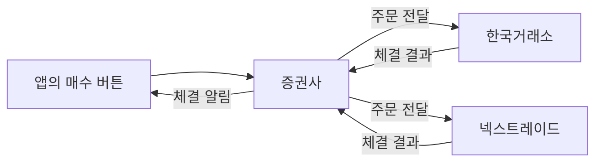
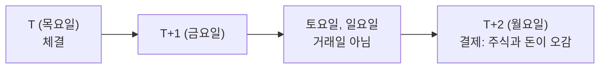
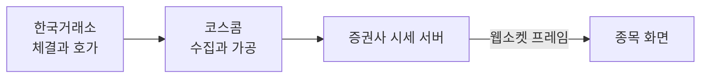

주식에 관해서는 "사고 판다"는 것 말고 아는 것이 거의 없었다. 앱에서 종목을 골라 매수 버튼을 누르면 주식이 생기고, 매도 버튼을 누르면 돈이 생긴다는 정도였다. 그런데 종목 화면으로 들어오는 체결 프레임을 들여다보니 뜻을 알기 어려운 값이 여럿 있었다. 체결은 사려는 사람과 팔려는 사람 사이에 거래가 성사되는 것을 말한다.

2026년 11월 19일 오후 2시 무렵, 토스증권 웹 화면에서 24초 동안 체결 프레임 686건을 받았다. 국내 종목 651건 중 182건은 `exchange`에 `krx` 대신 `nxt`가 적혀 있었다. 미국 종목 35건은 미국 동부 시간으로 자정 직전에 체결됐는데 `session`은 `DAY`였다. 국내 종목 중 9건에는 가격이 올랐다는 뜻의 `UP` 대신 `UPPER_LIMIT`가 들어 있었다. 그날 한국 주식시장은 평소보다 1시간 늦게 열렸다.[^1]

[증권 체결 웹소켓 서버 만들기](/series/websocket-trade-server) 시리즈의 첫 편에서는 서버를 다루기 전에 이 값들의 뜻부터 정리한다. 삼성전자 10주를 사는 주문을 예로 들어 누구에게, 얼마에 몇 주를, 언제 사는지와 산 뒤에 남는 일을 따라가 본다. 마지막에는 이 과정에서 화면으로 전달되는 시세를 프레임의 필드와 연결해 본다. 예시에 쓰는 가격은 2026년 11월 20일 거래가 끝났을 때의 실제 호가다.

증권 제도는 생각보다 자주 바뀐다. 2025년 3월에는 두 번째 주식 거래소가 문을 열었고, 2026년 9월에는 한국거래소의 거래 시간이 저녁 8시까지 늘어났다. 이 글은 2026년 11월 21일을 기준으로 썼다. 규정과 수치의 출처는 각주에 달았고, 증권사마다 달라지는 조건은 본문에 따로 적었다.

## Table of Contents

## 누구에게 사는가

주식을 사려면 누군가는 그 주식을 팔아야 한다. 거래소는 서로 모르는 사람들이 낸 매수 주문과 매도 주문을 연결해 준다. 한국 주식은 대부분 한국거래소(KRX)에 상장돼 있다. 상장은 거래소에서 사고팔 수 있도록 종목을 등록하는 것이다. 한국거래소에는 유가증권시장(흔히 코스피라고 부른다), 코스닥, 코넥스가 있고, 삼성전자는 유가증권시장 종목이다.

투자자는 거래소에 직접 주문을 낼 수 없다. 한국거래소의 회원인 증권사에 계좌를 열고 주문을 맡기면 증권사가 거래소에 제출한다. 한국거래소는 회원 증권사가 고객에게 받은 주문을 곧바로 제출하도록 정하고 있다. 체결 결과도 증권사를 거쳐 고객에게 전달된다.[^2] 앱에서 삼성전자 10주를 사는 주문을 넣어도 먼저 증권사로 가는 이유다.



### 거래소가 두 곳이 된 뒤

2025년 3월 4일 넥스트레이드(NXT)가 영업을 시작하면서 증권사가 주문을 보낼 곳이 늘었다. 넥스트레이드는 법적으로 다자간매매체결회사이며, 흔히 대체거래소(ATS, Alternative Trading System)라고 부른다.[^3] 종목을 새로 상장하지는 않고, 한국거래소에 상장된 종목 중 일부를 골라 거래한다. 대상 종목은 출범 한 달 만에 800개 가까이로 늘었다. 이후 대체거래소의 거래량을 한국거래소 대비 일정 비율 아래로 제한하는 시행령 때문에 2026년에는 600개 남짓으로 줄었다는 보도가 있다.[^4]

넥스트레이드가 생기기 전까지 한국 주식은 한국거래소 한 곳에서만 거래됐다. 상장 주식을 거래소 밖에서도 사고팔 수 있도록 다자간매매체결회사 제도를 도입한 것은 2013년이다. 금융위원회는 증권시장 인프라를 다양화하고 투자자의 거래 편의를 높이기 위한 제도라고 설명한다. 하지만 도입 후 10년 동안 인가를 받은 곳이 없다가, 2023년 7월 넥스트레이드가 처음으로 예비인가를 받았다.[^3]

금융위원회는 넥스트레이드가 문을 열면 두 거래소를 합쳐 하루 거래 시간이 12시간으로 늘어나고, 주문의 종류도 다양해질 것으로 기대했다. 거래소 간 수수료 경쟁으로 거래 비용이 줄어드는 효과도 기대했다. 넥스트레이드는 증권사가 내는 매매체결 수수료를 한국거래소보다 20~40% 낮게 받겠다고 했다.[^3] 한국거래소도 넥스트레이드 출범일에 맞춰 중간가 호가를 도입했고, 2026년 9월에는 저녁 8시까지 거래하는 애프터마켓을 열었다. 중간가 호가는 뒤의 "주문의 종류"에서 다룬다.

같은 삼성전자를 두 곳에서 팔 수 있으니 증권사는 주문을 어디로 보낼지 정해야 한다. 증권사에는 고객에게 가장 유리한 조건으로 주문을 처리할 의무(최선집행의무)가 있다. 그래서 증권사는 두 거래소에서 지금 사고팔 수 있는 가격을 비교해 주문을 보낼 곳을 고르는 시스템(SOR, Smart Order Routing)을 갖춘다.[^3] 어느 시간에 어느 거래소로 보내는지는 증권사마다 정한 기준을 따른다.

캡처에서도 두 거래소를 구분할 수 있었다. 국내 체결 651건 중 한국거래소가 469건, 넥스트레이드가 182건(28%)이었다. 삼성전자만 보면 415건 중 98건이 넥스트레이드 체결이었다. `exchange`는 어느 거래소에서 체결됐는지 나타내는 필드로 보인다.

### 종목 코드

주문서에는 종목도 적어야 한다. 삼성전자의 종목 코드는 `005930`이다. 이 여섯 자리 숫자를 단축코드라고 부르고, 국제 표준을 따르는 12자리 표준코드(ISIN)는 `KR7005930003`이다.[^5] 표준코드는 국가 코드 `KR`과 아홉 자리 식별 번호, 마지막 검사 숫자 한 자리로 되어 있고, 가운데에 단축코드 `005930`이 그대로 들어 있다. ISIN의 검사 숫자 계산법(알파벳을 숫자로 바꾼 뒤 Luhn 알고리즘을 적용한다)으로 앞의 11자리를 계산해 보면 실제로 마지막 숫자 3이 나온다.

`A005930`처럼 앞에 `A`를 붙인 형태도 자주 보인다. 한국거래소의 단축코드 체계에서 첫 글자는 상품의 종류를 나타내고, 주식은 `A`, ETN은 `Q`다.[^6] 캡처한 구독 주소도 `/topic/v1/kr/stock/trade/A005930`이었다.

미국 주식은 `AAPL` 같은 티커(ticker)로 부르는 것이 보통이다. 그런데 캡처의 미국 종목 구독 주소에는 티커 대신 `US19990122001`, `NAS0231213008` 같은 값이 들어 있었다. 거래소 이름으로 보이는 접두어와 숫자로 되어 있어서, 증권사가 해외 종목에 붙인 자체 식별자로 짐작한다.

## 얼마에, 몇 주를 사는가

### 호가와 체결

주문에는 가격과 수량이 들어간다. "180,900원에 10주를 사겠다"처럼 가격을 정해 내는 주문을 호가라고 부르고, 거래소에 들어온 호가는 가격별로 모여 호가창이 된다. 아래는 2026년 11월 20일 거래가 모두 끝난 뒤 네이버페이 증권에서 본 삼성전자 호가창이다.[^7]


위쪽 파란 영역은 매도 호가, 아래쪽 붉은 영역은 매수 호가다. 가장 싸게 팔겠다는 가격인 매도 1호가는 180,900원이고, 이 가격에 2,561주가 쌓여 있다. 가장 비싸게 사겠다는 가격인 매수 1호가는 180,800원이고, 수량은 590주다. 두 가격이 100원 벌어져 있어 이 상태로는 거래가 일어나지 않는다. 한국거래소는 매수와 매도 각각 가장 좋은 가격부터 10단계까지의 호가와 그 가격에 쌓인 수량(잔량)을 공개한다.[^8] 화면의 20개 가격은 이 호가들을 보여 준다.

테두리를 친 180,900원은 마지막 체결 가격이고, 가격 옆의 퍼센트는 기준가격(196,900원)과 비교한 등락률이다. 이날 삼성전자의 정규장 종가는 183,100원(-7.01%)이었다. 애프터마켓이 끝났을 때는 기준가격보다 8% 넘게 낮은 가격에 거래를 마쳤다.

이미 장이 끝난 뒤여서 이때는 주문을 내도 체결되지 않는다. 장이 열려 있었다고 가정해 보자. 이 호가창에 180,900원에 10주를 사겠다는 주문이 들어오면, 같은 가격에 팔려고 기다리던 2,561주 중 10주와 **체결**된다. 나머지 2,551주는 호가창에 남는다. 더 싼 가격의 매도 호가가 있으면 그 호가가 우선이고, 가격이 같으면 먼저 들어온 호가부터 체결된다. 이를 가격 우선, 시간 우선 원칙이라고 부른다.[^9]

<LiveDemo src="/demos/websocket-trade-server-securities-basics/index.html?view=book" title="장이 열려 있었다면 주문이 호가창과 어떻게 맞춰지는지 버튼으로 비교한다. 가격이 맞으면 바로 체결되고, 맞지 않으면 줄을 선다" height={426} />

이 예에서는 매수자가 매도 호가에 맞춰 주문을 냈다. 증권사 화면에서는 이런 거래를 매수 체결로 분류한다. 반대로 매도자가 매수 호가에 맞춰 주문을 내면 매도 체결로 분류한다.[^10] 프레임의 `tradeType`에 들어 있는 `BUY`와 `SELL`도 이 구분으로 보인다. 캡처에서는 `BUY`가 457건, `SELL`이 229건이었다.

### 호가 단위

호가창에 표시된 가격이 100원 간격인 이유는 호가 단위 때문이다. 주문 가격은 가격대마다 정해진 단위에 맞춰야 한다.[^11]

| 가격대                    | 호가 단위 |
| ------------------------- | --------- |
| 2,000원 미만              | 1원       |
| 2,000원 이상 5,000원 미만 | 5원       |
| 5,000원 이상 2만 원 미만  | 10원      |
| 2만 원 이상 5만 원 미만   | 50원      |
| 5만 원 이상 20만 원 미만  | 100원     |
| 20만 원 이상 50만 원 미만 | 500원     |
| 50만 원 이상              | 1,000원   |

18만 원대인 삼성전자는 100원 단위로만 호가를 낼 수 있어서, 180,850원에 사겠다는 주문은 낼 수 없다. 지금의 구간은 2023년 1월 25일에 유가증권시장과 코스닥을 같은 표로 맞추면서 정해졌다.[^11]

그런데 캡처한 국내 체결 중 22건(한국거래소 16건, 넥스트레이드 6건)은 가격이 정확히 호가 단위의 절반에 놓여 있었다. 위 호가창으로 치면 180,800원과 180,900원 사이의 180,850원 같은 가격이다. 2025년 3월부터는 두 거래소 모두 매수 1호가와 매도 1호가의 한가운데 가격으로 체결되는 중간가 호가를 받는다.[^12] 위 호가창처럼 두 호가의 차이가 한 단위일 때 중간가 호가로 체결되면 이런 가격이 나온다. 22건이 실제로 중간가 호가로 체결된 것인지는 프레임만으로는 알 수 없다.

### 주문의 종류

가격을 정해 내는 주문만 있는 것은 아니다. 한국거래소가 받는 주문의 종류는 다음과 같다.[^13]

| 종류         | 뜻                                                                                  |
| ------------ | ----------------------------------------------------------------------------------- |
| 지정가       | 정한 가격이나 그보다 유리한 가격에만 체결된다                                       |
| 시장가       | 가격 없이 수량만 정하고, 지금 가장 좋은 가격에 바로 체결된다                        |
| 조건부지정가 | 장중에는 지정가로 있다가, 체결되지 않으면 장 마감 직전인 3시 20분에 시장가로 바뀐다 |
| 최유리지정가 | 주문이 들어온 순간 상대편의 가장 좋은 가격이 주문 가격이 된다                       |
| 최우선지정가 | 주문이 들어온 순간 내 편의 가장 좋은 가격이 주문 가격이 된다                        |
| 중간가       | 매수 1호가와 매도 1호가의 한가운데 가격으로 체결된다                                |

여기에 조건을 붙일 수도 있다. IOC(Immediate or Cancel)는 지금 체결할 수 있는 만큼만 체결하고 나머지를 취소하고, FOK(Fill or Kill)는 전부 지금 체결할 수 있을 때만 체결하고 아니면 전부 취소한다. 넥스트레이드는 여기에 가격이 정한 수준에 닿으면 지정가 주문이 되는 스톱지정가 호가를 더했다.[^3]

장중에 위의 호가창 상태에서 삼성전자 주문을 180,900원 지정가로 냈다면 바로 체결된다. 180,800원 지정가로 냈다면 매수 호가 맨 위의 590주 뒤에 줄을 서서, 누군가 180,800원에 팔기를 기다리게 된다.

### 하루에 움직일 수 있는 폭

한국 주식은 하루에 오르내릴 수 있는 폭이 기준가격의 위아래 30%로 정해져 있다. 하루 동안 오를 수 있는 최고 가격을 상한가, 내려갈 수 있는 최저 가격을 하한가라고 부른다.[^14] 기준가격은 보통 전날 종가(정규장에서 마지막으로 체결된 가격)다. 가격제한폭은 1995년 6%에서 시작해 8%, 12%, 15%를 거쳐 2015년 6월 15일부터 30%가 됐다. 상한가는 기준가격에 0.3을 곱하고 호가 단위에 못 미치는 금액을 버린 뒤, 그 값을 기준가격에 더해 구한다.[^14]

앞의 호가창에서 삼성전자의 기준가격은 196,900원이었다. 여기에 0.3을 곱하면 59,070원이다. 기준가격의 호가 단위(100원)보다 작은 금액을 버리면 59,000원이 남고, 이를 기준가격에서 빼면 하한가 137,900원이 된다. 더하면 255,900원인데, 이 가격은 20만 원 이상 구간이라 호가 단위가 500원이다. 다시 호가 단위에 맞춰 금액을 버리면 상한가는 255,500원이 된다.

캡처에서 `UPPER_LIMIT`가 붙은 9건은 두 종목의 체결이었다. 두 종목 모두 프레임의 `base`를 이 계산식에 넣어 구한 상한가와 `close`가 9건 전부 같았다. `base`가 가격제한폭의 기준가격이라는 것도 이 계산으로 함께 확인된다.

미국에는 한국 같은 하루 가격제한폭이 없다. 대신 정규장(미국 동부 시간 오전 9시 30분부터 오후 4시)에는 최근 5분 평균 가격을 기준으로 종목마다 거래 가능한 가격 범위를 정한다. 이 범위 밖의 체결을 막는 제도가 LULD(Limit Up-Limit Down)다. 가장 좋은 매수 호가나 매도 호가가 범위의 끝에 걸린 상태로 15초가 지나면 그 종목의 거래를 5분 동안 멈춘다.

가격 범위의 폭은 종목과 가격, 시간에 따라 다르다. 전날 종가가 3달러를 넘는 종목 중 S&P 500이나 Russell 1000에 포함된 종목은 5%, 그 밖의 종목은 10%다. 3달러 이하 종목에는 더 넓은 폭을 적용하고, 정규장 마지막 25분에는 폭을 두 배로 넓히는 종목도 있다. 시장 전체의 거래를 멈추는 장치도 있다. 일반 거래일 기준 미국 동부 시간 오후 3시 25분 전에 S&P 500이 전날 종가보다 7%, 13% 떨어지면 각 단계에서 15분간 멈춘다. 20% 하락하면 정규장 중 시각과 관계없이 그날 거래를 끝낸다.[^15] 호가 단위는 1달러 이상 종목이 0.01달러다.

### 몇 주를 사는가

국내 주식은 1주 단위로 거래한다.[^11] 1주가 180,900원이면 10주는 1,809,000원이고, 10만 원어치만 사는 주문은 거래소에 낼 수 없다.

소수점 거래는 증권사가 고객의 주문을 모아 처리한다. 국내 주식의 경우, 증권사가 소수점 주문을 모아 1주가 되는 만큼 거래소에서 산다. 그 주식을 한국예탁결제원에 신탁하고 수익증권으로 나눠 고객에게 준다. 해외 주식은 증권사의 계좌부에 고객의 소수단위 지분을 직접 기록한다.[^16]

국내 주식 소수단위 거래는 2021년 9월 금융위원회가 허용 방침을 발표한 뒤, 혁신금융서비스로 지정받은 증권사들이 2022년부터 제공하기 시작했다.[^16] 2025년 5월에는 이 구조를 시행령에 넣어 정식 제도로 만드는 개정안이 예고됐다. 현재는 개정안이 시행돼 여러 증권사가 서비스를 제공하고 있다.

캡처한 체결 686건의 `volume`도 국내와 미국 모두 정수였다. 소수점 주문이 증권사 안에서 1주 단위로 모인 뒤 거래소로 나간다는 구조와 어긋나지 않는다. 다만 미국 종목은 35건뿐이어서 이것만으로 확인되는 것은 아니다.

## 언제 사는가

### 한국거래소와 넥스트레이드의 하루

주식시장이 9시에 열고 3시 30분에 닫는다는 말은 정규장 기준이다. 그 앞뒤로도 거래할 수 있고, 시간대에 따라 체결 방식이 달라진다. 2026년 11월 기준 평일 일정은 다음과 같다.[^17]

<LiveDemo src="/demos/websocket-trade-server-securities-basics/index.html?view=day" title="한국거래소와 넥스트레이드의 하루. 막대에 손을 올리면 정확한 시각이 보인다" height={340} />

구간별 정확한 시각은 다음과 같다.

| 한국 시간   | 한국거래소                                      | 넥스트레이드                          |
| ----------- | ----------------------------------------------- | ------------------------------------- |
| 08:00~08:30 | 열지 않음                                       | 프리마켓 (접속매매)                   |
| 08:30~08:50 | 시가 단일가 호가 접수, 장전 시간외 종가(~08:40) | 프리마켓 (접속매매)                   |
| 08:50~09:00 | 시가 단일가 호가 접수                           | 쉼                                    |
| 09:00~15:20 | 정규장 (접속매매)                               | 메인마켓 (접속매매, 9시 0분 30초부터) |
| 15:20~15:30 | 종가 단일가                                     | 쉼                                    |
| 15:30~15:40 | 장후 시간외 종가 호가 접수                      | 애프터마켓 호가 접수, 종가매매        |
| 15:40~16:00 | 장후 시간외 종가                                | 애프터마켓 (접속매매), 종가매매       |
| 16:00~20:00 | 애프터마켓 (접속매매)                           | 애프터마켓 (접속매매)                 |

시간표의 **접속매매**와 **단일가매매**는 주문을 체결하는 방식이다. 금융위원회는 접속매매를 "가격이 합치되는 즉시 매매체결이 이루어지는" 방식으로, 단일가매매를 "호가를 접수받아 하나의 가격으로 동시에 체결하는" 방식으로 설명한다.[^3] 앞에서 180,900원에 사겠다는 주문이 들어오자마자 체결된 예가 접속매매다. 새 주문이 들어올 때마다 호가창과 맞춰 보므로 체결 가격은 매번 달라질 수 있다.

단일가매매에서는 정해진 시간 동안 주문만 받는다. 시간이 끝나면 모인 주문 전체를 보고 가격 하나를 정해 한꺼번에 체결한다.[^18] 이때 지정가 주문은 정한 가격보다 유리한 가격에도 체결될 수 있다. 181,200원 매수 주문은 "181,200원까지는 내겠다"는 의미이므로 더 싸게 살 수 있다. 180,600원 매도 주문도 "180,600원 이상이면 팔겠다"는 의미여서 더 비싸게 팔 수 있다.

8시 30분부터 9시까지 삼성전자에 아래 주문만 들어왔다고 해 보자(설명을 위해 정한 값이다).

| 매도 수량 | 가격    | 매수 수량 |
| --------- | ------- | --------- |
| 600       | 181,200 | 300       |
| 400       | 181,000 | 500       |
|           | 180,800 | 400       |
| 200       | 180,600 |           |

가격이 181,000원으로 정해졌다고 가정해 보자. 이 가격에 살 수 있는 매수 주문은 181,200원까지 내겠다는 300주와 181,000원까지 내겠다는 500주를 합쳐 800주다. 팔 수 있는 매도 주문은 180,600원 이상이면 팔겠다는 200주와 181,000원 이상이면 팔겠다는 400주를 합쳐 600주다. 매도 수량이 더 적으므로 실제로 거래할 수 있는 수량은 600주다. 다른 가격도 같은 방법으로 계산할 수 있다. 아래에서 가격을 누르면 그 가격에 체결 가능한 주문과 수량을 볼 수 있다.

<LiveDemo src="/demos/websocket-trade-server-securities-basics/index.html?view=auction" title="가격 후보마다 사겠다는 수량, 팔겠다는 수량, 실제로 거래할 수 있는 수량" height={515} />

가격을 181,200원으로 높이면 사려는 주문이 300주로 줄고, 180,800원 이하로 낮추면 팔려는 주문이 200주로 줄어든다. 그 사이인 181,000원에서 거래할 수 있는 수량이 가장 많고, 이 예에서는 이 가격이 그날의 시가가 된다. 한국거래소 규정에 적힌 방식대로 가장 비싸게 사겠다는 주문과 가장 싸게 팔겠다는 주문부터 차례로 짝을 지어도 같은 600주, 같은 181,000원이 나온다.[^18]

600주는 모두 181,000원에 체결된다. 181,200원까지 내겠다던 사람은 200원 싸게 사고, 180,600원 이상이면 팔겠다던 사람은 400원을 더 받는다. 181,000원 매수 주문 500주 중 200주는 매도 수량이 부족해 체결되지 않는다. 180,800원 매수와 181,200원 매도는 가격이 맞지 않아 그대로 남는다.

같은 주문이 9시 이후에 하나씩 들어왔다면, 들어온 순서에 따라 서로 다른 가격에 체결됐을 것이다. 단일가매매에서는 30분 동안 모은 주문을 한꺼번에 처리하므로 체결 가격이 하나로 정해진다.

시가와 종가는 하루를 대표하는 가격이므로, 주문을 충분히 모아 가격을 정한다. 먼저 들어온 몇 건의 주문만으로 가격이 결정되는 것을 피하기 위해서다. 한국거래소는 단일가매매를 "수요와 공급을 집중시켜 균형가격형성의 필요성이 큰 경우"에 쓰는 방식이라고 설명한다.[^18]

시가를 정할 때는 8시 30분부터 9시까지, 종가를 정할 때는 3시 20분부터 3시 30분까지 주문을 모은다. 그동안은 체결 없이, 지금 마감하면 얼마에 체결될지 계산한 예상체결가를 보여 준다. 시가 단일가매매에서는 마지막 10분인 8시 50분부터 9시까지만 예상체결가를 공개한다.[^3]

마감 시각에도 변동이 있다. 시가 단일가매매는 9시, 종가 단일가매매는 3시 30분이 지난 뒤 30초 안의 임의의 시점에 끝난다. 정확한 종료 시각을 알면 직전에 호가를 넣었다 빼면서 예상체결가와 시가를 움직이기 쉬워진다. 한국거래소 규정에도 불공정거래를 막기 위한 장치라고 적혀 있다.[^18]

정규장 앞뒤에는 종가로만 거래하는 시간도 있다. 장전 시간외 종가매매(8시 30분부터 8시 40분)에는 전날 종가로, 장후 시간외 종가매매(3시 40분부터 4시)에는 그날 종가로 거래한다. 2026년 9월 14일부터는 4시부터 8시까지 접속매매 방식의 애프터마켓이 열린다. 이에 따라 기존의 시간외 단일가매매(4시부터 6시까지 10분마다 단일가로 체결하던 구간)는 없어졌다.[^17]

애프터마켓의 가격제한폭도 전날 종가 기준 30%다. 하지만 애프터마켓에서 가격이 달라져도 그날의 공식 종가는 3시 30분에 정해진 가격으로 유지된다. 앞의 호가창에서 애프터마켓의 마지막 가격은 180,900원이었지만, 그날의 종가는 정규장에서 정해진 183,100원이다.[^7]

넥스트레이드는 아침 8시부터 8시 50분까지 프리마켓, 9시 직후부터 3시 20분까지 메인마켓, 3시 30분부터 8시까지 애프터마켓을 운영한다.[^3] 증권사 안내에 따르면 메인마켓은 9시 0분 30초에 시작한다. 애프터마켓은 3시 30분부터 주문을 받되 처음 10분 동안은 주문만 모으고, 3시 40분부터 체결한다. 이와 별도로 3시 30분부터 4시까지는 한국거래소의 그날 종가로만 거래하는 종가매매시장도 열린다.[^19]

한국거래소가 시가 예상체결가를 공개하는 8시 50분부터 9시까지, 그리고 종가 단일가매매가 진행되는 3시 20분부터 3시 30분까지는 넥스트레이드가 거래를 멈춘다. 두 구간은 각각 10분이다. 금융위원회는 시가와 종가의 대표성을 지키고, 두 체결 방식의 차이를 이용한 시세조종을 막기 위해서라고 설명한다.[^3] 메인마켓이 9시 정각이 아닌 9시 0분 30초에 시작하는 것도 한국거래소의 시가 단일가매매가 9시 이후 30초 안에 끝나는 일정과 맞아떨어진다.

삼성전자 주문도 언제 넣느냐에 따라 다르게 처리된다. 8시 10분이라면 넥스트레이드 프리마켓에서 바로 체결될 수 있다. 8시 55분에는 넥스트레이드가 쉬고 한국거래소는 호가를 모으는 중이다. 이때 낸 주문은 9시 직후 시가가 정해질 때 다른 주문들과 함께 체결되거나, 조건이 맞지 않으면 남는다. 모아 둔 주문을 한꺼번에 체결하는 9시와 3시 30분에는 체결 시세도 몰릴 가능성이 높다. 체결 프레임을 보내는 서버에서도 이 시간대의 부하를 고려해야 할 것이다.

### 거래가 잠시 멈추는 경우

가격이 짧은 시간에 크게 움직이면 거래 방식이 잠시 바뀐다. 종목 하나에 걸리는 장치가 변동성완화장치(VI, Volatility Interruption)다. 직전 체결가에서 일정 비율 이상 움직이면 걸리는 동적 VI와, 직전 단일가매매 가격(시가가 정해지기 전에는 전날 종가)에서 10% 이상 움직이면 걸리는 정적 VI가 있다. 어느 쪽이든 걸리면 그 종목은 2분 동안 단일가매매로 바뀐다.[^20]

| 구분                        | 동적 VI (정규장, 애프터마켓) | 동적 VI (장 마감 단일가) | 정적 VI |
| --------------------------- | ---------------------------- | ------------------------ | ------- |
| 코스피200 구성 종목         | 3%                           | 2%                       | 10%     |
| 그 밖의 코스피, 코스닥 종목 | 6%                           | 4%                       | 10%     |

삼성전자는 코스피200 구성 종목이다. 직전 체결가가 180,900원이라면 다음 체결 가격이 그 가격의 3%인 5,427원 이상 움직일 때 동적 VI가 걸린다.

시장 전체가 급락할 때는 거래 자체를 멈춘다. 코스피가 전날 종가보다 8% 이상 떨어진 상태가 1분 이어지면 20분 동안 모든 거래를 멈춘다(서킷브레이커 1단계). 15%에서는 한 번 더 멈추고, 20%에서는 그날 거래를 끝낸다. 1단계와 2단계는 하루에 한 번씩만 발동한다. 종가를 정할 시간을 남겨 두기 위해 장 종료 40분 전(평소에는 오후 2시 50분)부터는 발동하지 않는다. 그날 거래를 끝내는 3단계는 그 뒤에도 발동할 수 있다. 서킷브레이커는 정규장에만 적용되며 애프터마켓에서는 발동하지 않는다.[^21]

코스피200 선물이 5% 이상 움직인 상태가 1분 이어지면 프로그램매매 호가만 5분 동안 멈추는 사이드카도 있다.[^21]

### 쉬는 날과 늦게 여는 날

토요일과 일요일, 공휴일, 5월 1일 노동절, 그리고 한 해의 마지막 평일(공휴일과 토요일은 빼고 센다)에는 시장이 열리지 않는다.[^17] 대학수학능력시험 날에는 정규장을 1시간 늦게 열고 1시간 늦게 닫는다. 2026년 수능일인 11월 19일의 정규장은 10시부터 4시 30분까지였고, 넥스트레이드는 그날 아침 프리마켓을 열지 않았다.[^22]

이 글에 쓴 프레임도 수능일에 캡처했다. 오후 2시 무렵이어서 평소보다 늦춰진 일정에서도 정규장에 해당했고, 국내 종목의 `session`은 모두 `REGULAR`였다.

### 미국 장과 서머타임

미국 주식의 정규장은 미국 동부 시간으로 9시 30분부터 4시까지다. 정규장 앞뒤로 프리마켓과 애프터마켓이 있는데, 시간은 거래소마다 다르다. 나스닥은 프리마켓이 새벽 4시부터, 애프터마켓이 저녁 8시까지다.[^23]

한국 시간으로 환산하려면 서머타임도 고려해야 한다. 미국은 3월 둘째 일요일 새벽 2시에 시계를 1시간 앞당기고, 11월 첫째 일요일 새벽 2시에 되돌린다. 이를 서머타임 또는 일광 절약 시간(Daylight Saving Time)이라고 부른다. 2026년에는 3월 8일부터 11월 1일까지 적용됐다.[^24] 한국에는 서머타임이 없어서 미국 동부와의 시차가 이 기간에는 13시간, 나머지 기간에는 14시간이다. 한국에서 보면 미국 장의 시작과 종료 시각이 1년에 두 번, 1시간씩 바뀐다.

| 미국 동부 시간      | 한국 시간 (서머타임 기간) | 한국 시간 (그 밖의 기간) |
| ------------------- | ------------------------- | ------------------------ |
| 4:00 프리마켓 시작  | 17:00                     | 18:00                    |
| 9:30 정규장 시작    | 22:30                     | 23:30                    |
| 16:00 정규장 마감   | 다음 날 5:00              | 다음 날 6:00             |
| 20:00 애프터마켓 끝 | 다음 날 9:00              | 다음 날 10:00            |

미국 정규장은 한국 시간으로 자정을 넘겨 이어진다. 미국의 금요일 장이 한국에서는 토요일 새벽에 끝난다. 화면에 "오늘"의 시세를 표시할 때도 어느 나라의 날짜를 기준으로 삼을지 정해야 한다. 프레임의 `dt`를 UTC로 보내는 것도 이런 시차와 관련이 있을 것으로 보인다. 미국의 휴장일도 따로 확인해야 한다. 2026년에는 11월 26일 추수감사절에 쉬고, 다음 날은 미국 동부 시간 오후 1시(한국 시간 11월 28일 새벽 3시)에 일찍 닫는다.[^23]

한국 낮에도 미국 주식을 사고팔 수 있다. 국내 증권사들이 미국의 대체거래소를 통해 제공하는 주간거래 서비스다. 2024년 8월 5일 급락장에서 미국 대체거래소 Blue Ocean이 접수한 주문을 일방적으로 취소한 일이 있었고, 국내 증권사들은 8월 16일부터 주간거래를 일제히 중단했다. 이후 Bruce, Moon 같은 대체거래소와도 계약을 맺어 거래 상대를 늘리고, 오류가 생기면 잔고를 되돌리는 장치를 갖췄다. 2025년 11월 4일에는 18개 증권사가 주간거래를 재개했다.[^25]

운영 시간은 증권사마다 다르다. 서머타임이 아닌 기간에는 오전 10시 무렵부터 오후 5시 30분 무렵까지 제공하는 곳도 있다.[^25] 한국 시간을 기준으로 보면 주간거래에 이어 프리마켓이 18시, 정규장이 23시 30분에 시작하고, 애프터마켓은 다음 날 10시까지 이어진다. 하루 중 미국 주식을 거래할 수 있는 시간이 그만큼 길어졌다.

<LiveDemo src="/demos/websocket-trade-server-securities-basics/index.html?view=us" title="한국 시간 하루 위에 놓은 미국 주식 거래 시간. 서머타임이 끝나면 모든 구간이 1시간씩 늦어진다" height={246} />

캡처한 미국 종목의 체결 시각은 한국 시간 11월 19일 오후 2시 무렵, 미국 동부 시간으로는 11월 18일 자정 직전이었다. 미국 거래소의 애프터마켓도 끝난 시각이니 `session:"DAY"`는 이 주간거래의 체결이라는 뜻으로 보인다.

주말에는 아직 미국 주식을 거래할 곳이 없지만, 거래 시간을 늘리려는 움직임은 있다. Bruce를 운영하는 Bruce Markets는 2026년 9월 30일, 규제 당국의 검토를 거쳐 몇 달 안에 주말 거래 세션을 열겠다고 발표했다.[^26] Blue Ocean도 2026년 3월, 토큰화한 미국 주식을 주말에 거래할 수 있도록 청산 회사 RQD Clearing, 미국의 증권 청산과 결제를 맡는 DTCC와 함께 청산과 결제 방식을 준비하고 있다고 밝혔다.[^27] 2026년 11월 21일까지 두 곳 모두 주말 세션을 열었다는 발표는 없었다.

주말 거래가 시작되면 시세 서버도 주말에 체결을 보내야 한다. 주말을 시스템 점검 시간으로 쓰기도 지금보다 어려워질 것이다. 토스증권 웹 화면에는 토요일인 11월 28일의 서비스 전체 점검 안내가 떠 있었다.

## 산 다음에는

### 체결과 결제

삼성전자 10주가 180,900원에 체결되면 앱에는 바로 "체결"이 뜬다. 이때 확정되는 것은 "이 가격에 이 수량을 거래하기로 했다"는 약속이다. 주식과 돈을 실제로 주고받는 결제는 체결일(T)로부터 2거래일 뒤(T+2)에 이뤄진다.[^2] 그 사이 거래소가 주고받을 주식과 대금, 거래 상대를 확정하는 절차를 청산이라고 부른다.[^28] 한국거래소는 모든 거래의 중간에서 중앙청산소(CCP) 역할을 한다. 회원 증권사들은 T+2일 오후 4시까지 거래소와 결제를 마친다.[^2]



목요일에 산 주식은 다음 주 월요일에 결제된다. 주식을 판 돈도 마찬가지여서, 판 당일에는 앱에 금액이 보여도 결제일이 되기 전에는 출금할 수 없다. 이 결제 기간을 하루로 줄이는 방안이 논의되고 있지만, 2026년 11월 현재는 T+2다.[^29] 미국은 2024년 5월 28일부터 T+1이다.[^30]

### 예수금과 증거금

계좌에 넣어 둔 돈 중 아직 주식을 사는 데 쓰지 않은 돈을 예수금이라고 부른다. 증권사 화면에는 예수금 옆에 D+1, D+2 예수금이 함께 나오는데, 이것은 결제를 앞둔 거래를 반영해 하루 뒤와 이틀 뒤에 남을 금액을 추정한 값이다.[^31] 오늘 판 주식의 돈은 D+2 예수금에 먼저 나타나고, 결제일이 되면 예수금이 된다.

증권사는 대금의 일부인 증거금만 있어도 주문을 받아 준다. 결제가 이틀 뒤에 이뤄지므로 나머지 대금은 결제일까지 채울 수 있다. 대금 중 얼마를 증거금으로 받아 둘지 정하는 비율이 증거금률이고, 증권사가 종목마다 정한다. 삼성전자의 증거금률이 40%라고 가정하면, 1,809,000원어치를 사는 주문을 723,600원으로 낼 수 있다. 금융위원회의 설명처럼 가진 돈의 2.5배까지 사는 것이다.[^32]

모자란 돈을 결제일까지 채우지 못하면 그 차액은 미수금이 된다. 미수금이 생기면 증권사는 결제일 다음 날 고객의 주식을 강제로 팔아 메우는데, 이것을 반대매매라고 부른다. 미수가 한 번 생긴 계좌는 이후 30일 동안 미수거래가 제한된다.[^32] 증권사에서 돈을 빌려 주식을 사는 신용거래도 있다. 산 주식이 담보가 되고, 주가가 떨어져 담보 가치가 증권사가 정한 비율 아래로 내려가면 역시 반대매매가 일어난다.

### 공매도

갖고 있지 않은 주식을 빌려서 먼저 파는 것을 공매도라고 부른다. 나중에 더 싼 가격에 사서 갚으면 그 차이가 이익이 된다. 한국에서는 2023년 11월 6일부터 모든 종목의 공매도가 금지됐다가, 빌리지 않고 파는 무차입 공매도를 막는 전산 시스템을 갖추는 조건으로 2025년 3월 31일에 다시 허용됐다.[^33]

### 비용과 계좌

주식을 사고팔 때 드는 비용은 증권사에 내는 수수료와, 팔 때 내는 세금인 증권거래세다. 수수료는 증권사가 정한다. 증권거래세는 2026년 1월부터 유가증권시장은 증권거래세 0.05%에 농어촌특별세 0.15%를 더해 0.20%, 코스닥은 0.20%라고 보도됐다.[^34] 삼성전자 10주를 180,900원에 팔면 매도 금액 1,809,000원의 0.20%인 3,618원이 세금이다.

주식을 사고파는 기본 계좌는 증권사에 매매를 맡긴다는 뜻에서 위탁계좌라고 부른다. 세금 혜택을 주는 ISA나 연금저축 같은 계좌는 따로 열고, 계좌마다 담을 수 있는 상품과 혜택이 다르다.

## 그사이 화면에는

### 시세가 오는 길

체결 정보는 거래 당사자에게 전달되고, 시세로도 시장 전체에 공개된다. 한국거래소의 체결과 호가, 지수 같은 정보는 코스콤이 실시간으로 모아 가공한 뒤 증권사와 정보 회사, 언론사에 보낸다.[^35] 증권사는 이용 계약을 맺고 정보이용료를 내야 이 시세를 받을 수 있다. 받은 시세는 자기 서버에서 앱과 웹으로 다시 보낸다.[^35] 넥스트레이드에서도 체결과 호가가 생기므로, 증권사 화면은 두 거래소의 시세를 합쳐 보여 주거나 거래소별로 나눠 보여 주기도 한다.

시세를 받는 조건은 서비스마다 다르다. 앞의 네이버페이 증권 호가창에 "20분지연, KRX 제공"이라고 적혀 있던 것처럼, 같은 종목이라도 실시간 시세를 보여 주지 않을 수 있다. 미국 시세도 거래소에 이용료를 내야 한다. 나스닥 베이직(Nasdaq Basic)은 일부 거래소의 정보만 담아 가격을 낮춘 시세 상품이다. 국내 증권사 중에는 이런 시세를 무료로 제공하고 전체 시세는 유료로 따로 제공하는 곳이 있다.[^36]



이 시리즈에서는 그림의 마지막 화살표에 해당하는 구간, 즉 증권사의 시세 서버에서 종목 화면까지를 다룬다. 그림은 시세가 전달되는 일반적인 흐름을 나타낸 것으로, 특정 증권사의 내부 구성을 조사한 결과는 아니다.

### 프레임의 필드를 다시 읽기

앞에서 설명한 용어를 바탕으로 캡처한 체결 프레임의 필드를 정리했다. 국내 종목에는 키 13개, 미국 종목에는 15개가 있었다.

| 키                                           | 캡처에서 본 값              | 뜻                                                                  |
| -------------------------------------------- | --------------------------- | ------------------------------------------------------------------- |
| `code`                                       | `A005930`, `US19990122001`  | 단축코드(국내), 증권사의 해외 종목 식별자로 보이는 값(미국)         |
| `dt`                                         | `2026-11-19T04:55:12Z`      | 체결 시각(UTC, 초 단위)                                             |
| `currency`                                   | `KRW`, `USD`                | 가격의 통화                                                         |
| `exchange`                                   | `krx`, `nxt`                | 체결된 거래소. 미국 종목에는 이 키가 없다                           |
| `session`                                    | `REGULAR`, `DAY`            | 거래 시간 구간. 국내는 정규장, 미국은 주간거래                      |
| `base`                                       | 숫자                        | 기준가격. 보통 전날 종가이고, 국내 종목에서는 가격제한폭의 기준이다 |
| `close`                                      | 숫자                        | 이번 체결의 가격(현재가)                                            |
| `volume`                                     | 정수                        | 이번 체결의 수량                                                    |
| `tradeType`                                  | `BUY`, `SELL`               | 매수 체결인지 매도 체결인지                                         |
| `changeType`                                 | `UP`, `DOWN`, `UPPER_LIMIT` | 기준가격보다 올랐는지 내렸는지, 상한가인지                          |
| `tradingStrength`                            | 100 안팎의 소수             | 체결강도                                                            |
| `cumulativeVolume`, `cumulativeAmount`       | 숫자                        | 그날의 누적 거래량(주)과 누적 거래대금(금액)                        |
| `baseKrw`, `closeKrw`, `cumulativeAmountKrw` | 숫자                        | 미국 종목만 있다. 달러 값을 원화로 바꾼 값                          |

필드 몇 개는 캡처한 값으로 계산해 보며 의미를 확인했다. `changeType`은 686건 중 677건에서 `close`와 `base`를 비교한 결과와 일치했다. 나머지 9건은 앞에서 확인한 상한가 체결이었다.

누적 거래대금을 누적 거래량으로 나누면 그날의 평균 체결 가격을 구할 수 있다. 국내 체결에서는 이 값이 `close`의 0.89배에서 1.00배 사이였다. `cumulativeAmount`를 주식 수가 아닌 금액으로 해석하는 근거다. 미국 종목의 원화 필드 세 개를 각각 원래 필드로 나눈 비율도 35건 모두 같은 값이었다. 같은 환율을 곱해 원화로 환산한 값으로 볼 수 있다.

`close`는 이름만 보면 종가로 생각하기 쉽다. 한국거래소는 정규장에서 마지막으로 체결된 가격을 그날의 공식 종가(closing price)로 정의한다.[^37] 그런데 프레임의 `close`는 장중에도 체결마다 바뀐다. 여기서는 "지금까지의 마지막 체결가", 즉 현재가를 나타낸다.

이 스트림에는 넥스트레이드의 체결도 섞여 온다. 또 두 거래소 모두 정규장 이후에 애프터마켓을 운영하므로, 마지막 체결 가격과 공식 종가를 구분해야 한다. 앞에서 본 애프터마켓의 마지막 가격은 180,900원, 그날의 종가는 183,100원이었다. 이 스트림이 정규장 이후의 체결도 `close`로 보내는지, 공식 종가는 따로 알려 주는지는 장중 24초 캡처로 확인할 수 없었다.

`tradingStrength`(체결강도)는 증권사 HTS에서 쓰던 분석 지표로, 거래소가 정한 지표는 아니다. 매수 체결 수량과 매도 체결 수량이 같으면 100이고, 100보다 크면 매수 체결 수량이 더 많았다고 본다. 다만 표시 방식은 증권사마다 달라서 100을 기준으로 삼기도 하고 50%를 기준으로 삼기도 한다.[^10] 프레임에서는 이 값의 유효 숫자가 19자리까지 나온다. JavaScript에서 이 숫자를 다룰 때 생기는 문제는 다음 편에서 살펴본다.

이제 앞에서 살펴본 삼성전자 주문을 프레임으로 표현해 보자. 장중에 한국거래소에서 10주가 180,900원에 체결됐다고 가정하고, 토스증권 웹 화면에서 관찰한 형식에 맞추면 다음과 같다. 키 순서는 캡처를 따랐다. 체결 시각과 체결강도, 누적값은 이 예시만으로 정할 수 없어 생략했다.

```json
{
  "code": "A005930",
  "currency": "KRW",
  "exchange": "krx",
  "session": "REGULAR",
  "base": 196900,
  "close": 180900,
  "volume": 10,
  "tradeType": "BUY",
  "changeType": "DOWN"
}
```

한국거래소에서 체결됐으므로 `exchange`는 `krx`다. 증권사의 SOR이 넥스트레이드로 주문을 보냈다면 `nxt`가 된다. 정규장 체결이므로 `session`은 `REGULAR`다. `base`에는 그날의 기준가격 196,900원, `close`에는 이번 체결 가격, `volume`에는 체결 수량 10주가 들어간다. 매도 1호가에 맞춰 산 거래여서 `tradeType`은 `BUY`, 체결 가격이 기준가격보다 낮아서 `changeType`은 `DOWN`이다. 그날 삼성전자의 누적 거래량에는 10주, 누적 거래대금에는 1,809,000원이 더해진다.

삼성전자 10주를 사는 주문을 따라가며 증권사가 거래소를 고르고, 가격과 시간에 따라 주문이 체결되고, 이틀 뒤 결제가 이뤄지는 과정을 살펴봤다. 처음에는 뜻을 알기 어려웠던 필드도 이 과정과 연결할 수 있었다. `exchange`에는 체결된 거래소, `session`에는 거래 시간 구간이 담기고, 가격제한폭의 상단에 닿은 체결에는 `UPPER_LIMIT`가 붙었다. 다음 편에서는 이 프레임이 서버에서 브라우저까지 어떻게 전달되는지 살펴본다.

[^1]: 캡처는 2026년 11월 19일에 로그인하지 않은 임시 프로필의 헤드리스 Chrome Beta 159로 토스증권 웹 화면에서 받았고, 23.8초 동안 구독 12개로 받은 `MESSAGE` 686건(국내 651건, 미국 35건)을 이 글에서 다시 셌다. 캡처 도구는 [yceffort/ws-trade-server](https://github.com/yceffort/ws-trade-server)에 있다. 캡처에 들어 있던 인증 헤더와 기기 식별자, 실제 시세 값은 이 글에 옮기지 않았다. 본문의 삼성전자 가격은 각주 7의 호가창에서 가져왔다.

[^2]: [KRX, General Procedures of Trading](https://global.krx.co.kr/contents/GLB/06/0602/0602010201/GLB0602010201T1.jsp). "Member firms entrusted with customer orders are obliged to immediately submit (quote) those orders to the KRX", "every member firm completes their required settlement transaction with KRX (as a CCP) by 16:00 of T+2"

[^3]: [금융위원회, 넥스트레이드의 다자간매매체결회사 투자중개업 본인가, 3월 4일 대체거래소(ATS) 출범 예정 (2025-02-05)](https://www.fsc.go.kr/po010102/83953). "증권시장 인프라를 다양화하고 투자자의 거래편의를 개선하는 등 자본시장 접근성을 제고하기 위해 '13년 다자간매매체결회사 제도를 도입하였으며, '23.7월 넥스트레이드가 최초로 예비인가를 획득하였다", "현행 한국거래소의 매매체결 수수료보다 20~40% 수준 인하할 예정", "시,종가의 대표성을 유지하고, 호가를 접수받아 하나의 가격으로 동시에 체결하는 단일가매매와 가격이 합치되는 즉시 매매체결이 이루어지는 접속매매의 차이를 활용한 시세조종을 방지하기 위함", "예상체결가 표출시간을 08시50분 ~ 09시의 10분간으로 단축하고, 동 10분 동안 넥스트레이드는 일시적으로 거래를 중단". 거래 시간, 새로운 호가(중간가호가, 스톱지정가호가), 최선집행의무와 SOR도 이 자료를 따랐다

[^4]: [이코노미스트, 2026-10-30](https://economist.co.kr/article/view/ecn202610260048). 대체거래소 거래량을 시장 전체 15%, 개별 종목 30%로 묶는 시행령과 거래 대상 종목 감소

[^5]: [한국예탁결제원 SEIBro, 삼성전자 종목 정보](https://seibro.or.kr/websquare/control.jsp?w2xPath=%2FIPORTAL%2Fuser%2Fstock%2FBIP_CNTS02006V.xml&menuNo=44&ISIN=KR7005930003)

[^6]: [이투데이, 한국거래소 단축코드 체계 개편 보도](https://www.etoday.co.kr/news/view/2251473). 단축코드 첫 자리는 금융상품 유형을 나타내며 주권은 A, ETN은 Q

[^7]: [네이버페이 증권, 삼성전자 시세](https://stock.naver.com/domestic/stock/005930/price). 2026년 11월 21일에 로그인하지 않은 브라우저로 열어 찍었고, 화면에는 11월 20일 애프터마켓이 끝난 뒤의 호가가 "20분지연, KRX 제공"이라는 표시와 함께 나와 있었고, 현재가 180,900원과 별도로 "정규장 종가 183,100"이 표시돼 있었다. 토스증권 웹 화면은 로그인해야 호가를 보여 줘서 이 화면을 썼다

[^8]: [KRX, Disclosure of Quotations](https://global.krx.co.kr/contents/GLB/06/0602/0602010204/GLB0602010204T6.jsp). "the prices of 10 successive best per bid and offer respectively, including the best bid and offer"

[^9]: [KRX, Trading Mechanism](https://global.krx.co.kr/contents/GLB/06/0606/0606020101/GLB0606020101T4.jsp). "Trades are executed by auctions according to the priorities of price and time", "Opening/closing prices are determined by single price auction"

[^10]: 매수 체결과 매도 체결의 구분과 체결강도의 정의는 증권사 HTS 도움말을 따랐다. [키움증권 HTS 도움말, 체결강도](https://download.kiwoom.com/hero4_help_new/1401.htm), [미래에셋증권 HTS 도움말, 체결강도](https://securities.miraeasset.com/kairos/0175.htm)

[^11]: [KRX, Tick and Trading Unit](https://global.krx.co.kr/contents/GLB/06/0602/0602020201/GLB0602020201.jsp). 2023년 1월 25일 개편은 [머니투데이방송 보도](https://news.mtn.co.kr/news-detail/2022110114103274390)

[^12]: 각주 3의 금융위원회 자료. "한국 거래소도 넥스트레이드 출범일에 맞추어 함께 새로운 호가를 제공할 계획". 한국거래소의 시행세칙 개정은 [파이낸셜뉴스 보도 (2025-02-27)](https://www.fnnews.com/news/202502271714150888)

[^13]: [KRX, Types of Orders](https://global.krx.co.kr/contents/GLB/06/0602/0602020202/GLB0602020202T5.jsp)

[^14]: [KRX, Daily Price Limits](https://global.krx.co.kr/contents/GLB/06/0602/0602010201/GLB0602010201T5.jsp). 기준가격은 [KRX, Base Price](https://global.krx.co.kr/contents/GLB/06/0602/0602020202/GLB0602020202T2.jsp)의 "Generally it is the previous day's closing price"

[^15]: [Limit Up Limit Down, Plan](https://www.luldplan.com). "The Plan is designed to prevent trades in NMS Stocks from occurring outside specified price bands", "The Plan applies during regular trading hours of 9:30 am ET - 4:00 pm ET", "If the market does not exit a Limit State within 15 seconds, the primary listing exchange declares a five-minute Trading Pause". 범위의 폭과 마지막 25분에 폭을 두 배로 넓히는 대상도 이 페이지의 표를 따랐다. 시장 전체의 거래 정지는 [Nasdaq Trader, Market-Wide Circuit Breakers](https://www.nasdaqtrader.com/trader.aspx?id=CircuitBreaker)를 따랐다. 1단계와 2단계는 "Before 3:25 p.m." "Halt 15 minutes", "At or after 3:25 p.m." "Trading continues, unless there is a Level 3"이고, 3단계는 "Halt remainder of Day"다

[^16]: [금융위원회, 국내 및 해외주식에 대한 소수단위 거래가 허용됩니다 (2021-09-13)](https://www.fsc.go.kr/po010103/76531), [금융위원회, 비상장주식, 조각투자, 국내주식 소수단위 거래 제도화 입법예고 (2025-05-08)](https://www.fsc.go.kr/po010101/84506). 2026년 10월에 국내 주식 소수점 거래를 새로 연 증권사의 사례는 [SBS Biz 보도](https://biz.sbs.co.kr/amp/article/20000338432)

[^17]: [KRX, Trading Hours](https://global.krx.co.kr/contents/GLB/06/0602/0602020204/GLB0602020204T1.jsp). 애프터마켓 도입과 시간외 단일가매매 폐지는 [전자신문 보도 (2026-09-11)](https://www.etnews.com/20260911000272). 넥스트레이드의 시간은 각주 3과 각주 19를 따랐다. 2026년 9월 14일부터 넥스트레이드에도 정적 VI와 단일가매매가 도입됐다는 [삼성증권 공지](https://www.samsungpop.com/ux/kor/customer/notice/notice/noticeViewContent.do?MenuSeqNo=24420)가 있다

[^18]: [KRX 법규서비스, 단일가매매시 체결방법](https://regulation.krx.co.kr/contents/RGL/03/03010201/RGL03010201.jsp). "단일가매매는 수요와 공급을 집중시켜 균형가격형성의 필요성이 큰 경우에 이용되는 매매방법으로서", "가장 높은 가격의 매수호가와 가장 낮은 가격의 매도호가를 순차적으로 체결시키고", "일정시간동안 매도, 매수호가를 접수하여 가격 및 시간우선원칙에 따라 우선하는 호가간에 하나의 가격으로 매매체결", "마감시점으로부터 불공정거래 예방 등을 위해 30초이내에서 거래소가 정하는 임의의 시간에 종료됩니다"

[^19]: [신한투자증권, 넥스트레이드 이용 안내](https://open.shinhansec.com/mobilealpha/html/CS/NXTPolicyGuide_v2.html). 메인마켓 시작 시각(09:00:30)과 함께 애프터마켓의 15:30\~15:40을 "애프터마켓 (시가 단일가)"로 적고 있다. 애프터마켓 체결 시작 시각과 종가매매시장은 [다올투자증권, 넥스트레이드 안내](https://www.daolsecurities.com/customer/task/BizNxtInfo.jsp)와 [한화투자증권, 복수시장 주식거래 안내](https://www.hanwhawm.com/main/center/info/CS181_2p.cmd)를 따랐다. 두 곳 모두 애프터마켓을 "15:40\~20:00 (15:30부터 접수가능)", 넥스트레이드 종가매매시장을 "호가접수시간(15:00\~16:00), 매매거래시간(15:30\~16:00) / KRX 당일종가로 체결"로 적고 있다. 한국거래소 장후 시간외 종가매매의 15:30\~15:40 호가 접수도 두 곳의 안내를 따랐다

[^20]: [KRX, Volatility Interruption](https://global.krx.co.kr/contents/GLB/06/0602/0602020204/GLB0602020204T7.jsp)

[^21]: [KRX 법규서비스, 유가증권시장 매매거래의 중단](https://regulation.krx.co.kr/contents/RGL/03/03010402/RGL03010402.jsp). "각 단계별로 발동은 1일 1회로 한정하고 당일종가결정시간 확보를 위해 장종료 40분전 이후에는 중단하지 않습니다", "3단계 매매거래중단은 40분전 이후에도 발동이 가능 합니다", "매매거래중단은 정규장 중에만 발동되며 애프터마켓에서는 발동하지 않습니다". 사이드카는 [KRX 법규서비스, 프로그램매매호가의 효력 일시정지](https://regulation.krx.co.kr/contents/RGL/03/03010404/RGL03010404.jsp)를 따랐다

[^22]: [SBS Biz, 수능일 주식 시장 1시간 늦게 열고 1시간 늦게 닫는다 (2026-11-05)](https://biz.sbs.co.kr/amp/article/20000344409)

[^23]: [NYSE, Holidays and Trading Hours](https://www.nyse.com/markets/hours-calendars), [Nasdaq, Stock Market Holiday Schedule](https://www.nasdaq.com/market-activity/stock-market-holiday-schedule)

[^24]: [15 U.S. Code § 260a](https://www.law.cornell.edu/uscode/text/15/260a), [NIST, Daylight Saving Time](https://www.nist.gov/pml/time-and-frequency-division/popular-links/daylight-saving-time-dst)

[^25]: [다음 뉴스, 해외주식 주간거래 재개 보도 (2025-11-04)](https://v.daum.net/v/K5h8TeFYG2). "블루오션 외에 '브루스(Bruce)'와 '문(Moon)' 등 신생 미국 ATS들과도 복수로 계약을 맺어 백업 기관을 두고 있다". 운영 시간의 예는 [신한투자증권 주간거래 안내](https://www.shinhansec.com/cms/contents/event/251104_USdaytime02_pc.html)

[^26]: [Bruce Markets 보도자료 (2026-09-30, Mondo Visione 게재)](https://mondovisione.com/news/markets-to-be-open-seven-days-a-week-bruce-markets-to-launch-first-continuous-w-2026930/). "extend U.S. equity trading throughout the weekend, subject to regulatory review", "New weekend session expected to go live in the coming months"

[^27]: [Blue Ocean Technologies, Blue Ocean Sees Weekend Trading as Tokenized Equities Advance (Traders Magazine 기사 게재, 2026-03-10)](https://blueocean-tech.io/2026/03/10/blue-ocean-weekend-trading-tokenized-equities/). "developments in tokenized securities infrastructure could eventually allow U.S. equities to trade over the weekend"

[^28]: [금융위원회 금융용어사전, 청산](https://www.fsc.go.kr/in090301/view?dicId=1831)

[^29]: [머니투데이, 2026-05-26](https://www.mt.co.kr/stock/2026/05/26/2026052617491832936)

[^30]: [SEC, Press Release 2024-62](https://www.sec.gov/news/press-release/2024-62)

[^31]: [키움증권 HTS 도움말, 예수금](https://download.kiwoom.com/hero4_help_new/0361.htm). 화면의 이름과 계산 방식은 증권사마다 조금씩 다르다

[^32]: [금융위원회, 미수거래 카드뉴스](https://www.fsc.go.kr/no040101?cnId=2172). "증거금율이 40%인 종목의 경우, 증거금의 최대 2.5배까지 매수 가능합니다", "미수금이 발생할 경우 다음 30일 동안은 미수거래가 제한되어"

[^33]: [금융위원회, 공매도 전면 금지 (2023-11-05)](https://www.fsc.go.kr/no010101/81013), [금융위원회, 공매도 재개 보도참고자료 (2025-03-21)](https://www.fsc.go.kr/po010107/84216)

[^34]: [택스타임즈, 내년 1월부터 증권거래세율 코스피 0.05%, 코스닥 0.20%로 상향](https://www.taxtimes.co.kr/news/article.html?no=272624)

[^35]: [코스콤, 시세 정보 서비스](https://www.koscom.co.kr/portal/main/contents.do?menuNo=200611), [코스콤, 자주 묻는 질문](https://www.koscom.co.kr/portal/main/contents.do?menuNo=200407)

[^36]: [Nasdaq, 미국 주식 시장 데이터 백서](https://www.nasdaq.com/docs/2024/US_Equity_Market_Data_Whitepaper_ko). 국내 증권사의 무료와 유료 시세 구성은 증권사마다 다르다

[^37]: [KRX, Base Price and Closing Price](https://global.krx.co.kr/contents/GLB/06/0602/0602010201/GLB0602010201T6.jsp). "Closing prices mean the prices lastly traded at the regular session"
